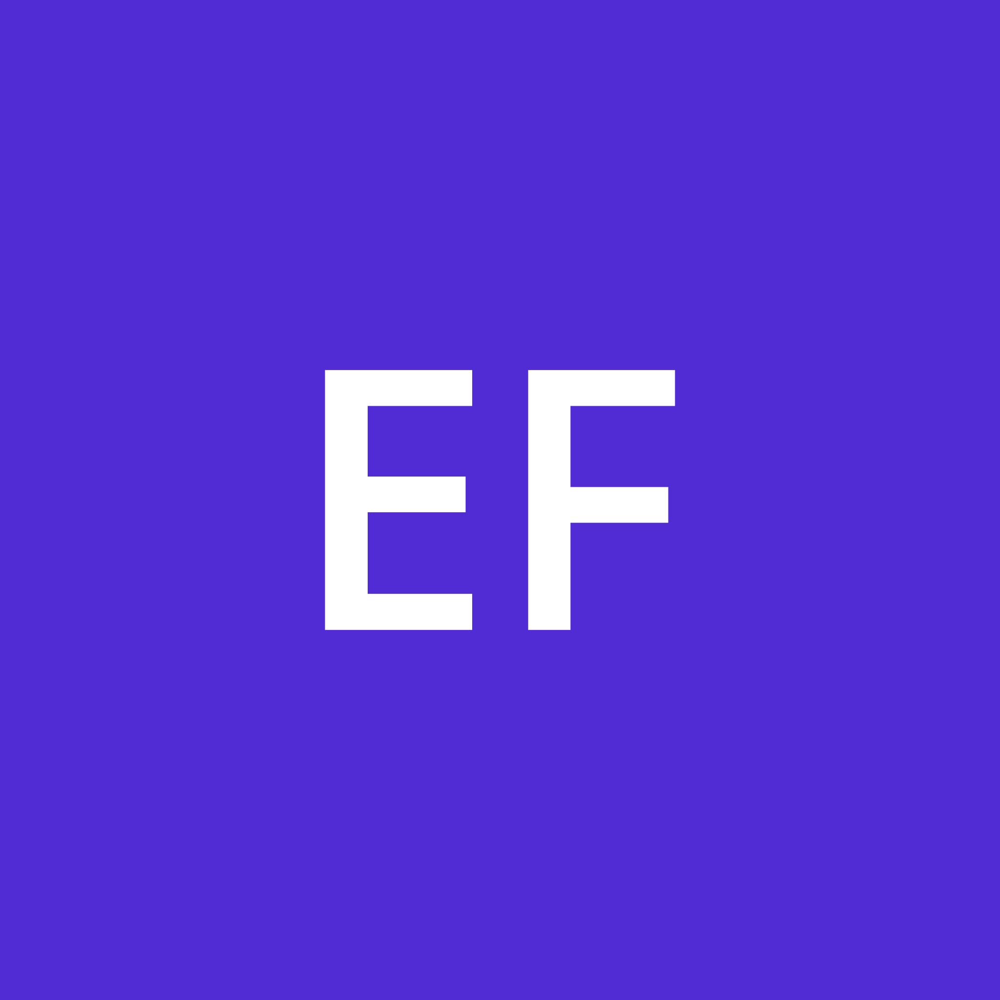
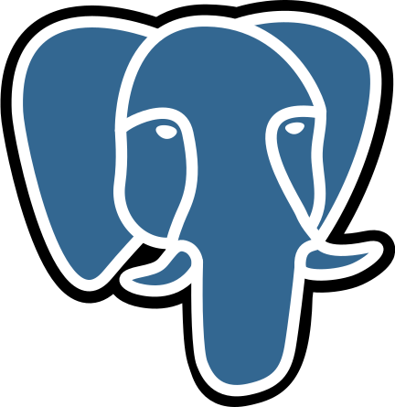
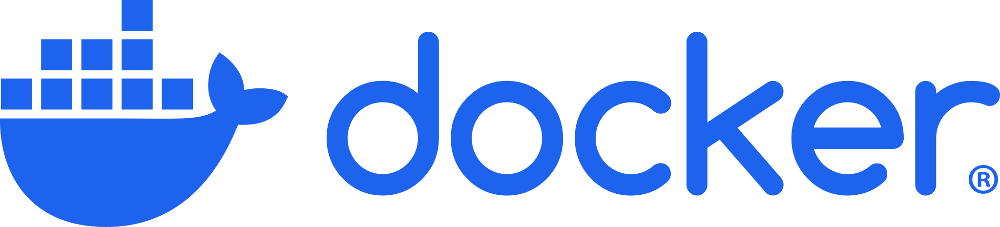
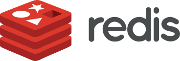

## NoMoreTears

Backend-система, яка представляє платформу для пошуку, підбору та виклику верифікованих профільних спеціалістів (майстрів) для вирішення побутових і технічних проблем клієнтів: ремонт техніки, сантехніка, електрика, клінінг і т.п. Frontend-система доступна за цим посиланням: [NoMoreTears-frontend](https://github.com/no-more-tears/NoMoreTears-frontend)

### 1. Технічний стек

  <table>
    <tr>
      <td align="center" valign="middle"><strong>Використані технології</strong></td>
      <td align="center" valign="top"> .NET 10</td>
      <td align="center" valign="top"> Entity Framework Core</td>
      <td align="center" valign="top"> PostgreSQL</td>
      <td align="center" valign="top"> Docker</td>
      <td align="center" valign="top"> Redis</td>
      <td align="center" valign="top"> RabbitMQ</td>
    </tr>
  </table>

### 2. Використані архітектурні підходи і паттерни

| Підхід / паттерн | Призначення |
|------------------|-------------|
| Modular Monolith | Єдиний деплой із чіткими межами між модулями. |
| Domain-Driven Design | Моделювання системи таким чином, що вся складність розміщена в єдиному місці. |
| Event-Driven Architecture | Взаємодія модулів через контракти у вигляді подій. |
| Clean Architecture | Seperation of Concerns в горизонтальному вигляді. |
| Outbox/Inbox | Надійна доставка та ідемпотентна обробка повідомлень. |

### 3. Навігація в документації

TODO

### 4. Як запустити систему

TODO

### 5. Ліцензія

Проект ліцензовано під [MIT License](https://github.com/no-more-tears/NoMoreTears/blob/main/LICENSE).