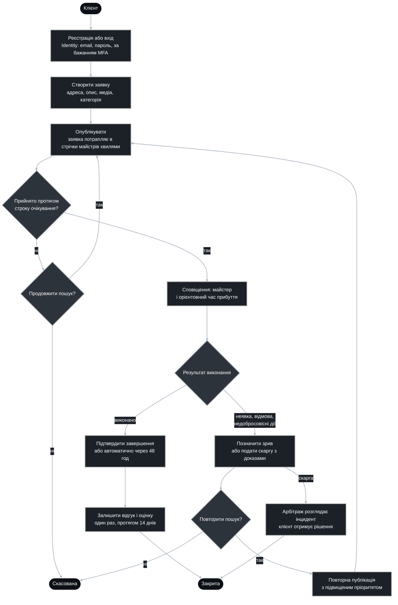
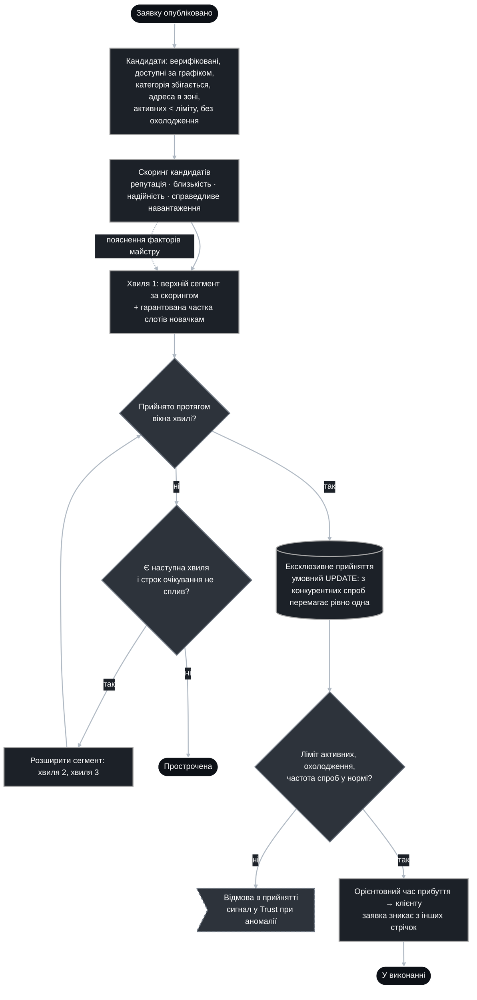

## Архітектура

Документ описує систему з погляду користувачів і вимог: учасники, основні процеси, функціональні (FR) та нефункціональні (NFR) вимоги, захист від шахрайства і алгоритм справедливості. Домен і його поділ на модулі описано в `domain-driven-design.md`, структура модуля — у `service-structure.md`, композиція модулів — у `modular-monolith.md`.

Числові параметри в документі є пропонованими початковими значеннями для production-запуску. Вони конфігуруються і підлягають підтвердженню бізнесом.

### 1. Огляд

| Учасник | Роль у коді | Що робить |
|--|--|--|
| Клієнт | `Client` | Створює заявки, підтверджує завершення, лишає відгуки, подає скарги. |
| Майстер | `Worker` | Проходить верифікацію, приймає заявки зі стрічки, виконує роботи. |
| Арбітр і верифікатор | `PlatformSupport` | Перевіряє документи майстрів, розглядає інциденти, накладає санкції. |
| Адміністратор платформи | `PlatformAdministrator` | Керує каталогом категорій і параметрами, розглядає апеляції, керує акаунтами. |
| Зовнішні системи | — | Шлюзи push, sms, email; геокодування адрес; об'єктне сховище медіа та документів. |

```mermaid
%%{init: {"theme":"base","themeVariables":{"fontFamily":"Segoe UI, Helvetica, Arial, sans-serif","primaryColor":"#1C2128","primaryTextColor":"#FFFFFF","primaryBorderColor":"#A5A5A5","lineColor":"#B1BAC4","edgeLabelBackground":"#1C2128","clusterBkg":"#0D1117","clusterBorder":"#A5A5A5","titleColor":"#FFFFFF"}}}%%
flowchart TD
    accTitle: Карта системи
    accDescr: Клієнти, майстри та платформні ролі працюють через web і mobile клієнти з єдиним хостом WebApi. Хост композиціює модулі Requests, Dispatch, Trust, Masters, Notification і провайдер Identity. Кожен модуль має власну схему в одній базі PostgreSQL. Notification звертається до зовнішніх шлюзів, Dispatch до геокодування, Requests і Masters до об'єктного сховища.

    U1["Клієнт"] --> App["Web і mobile клієнти"]
    U2["Майстер"] --> App
    U3["PlatformSupport<br/>PlatformAdministrator"] --> App
    App -->|"HTTPS, JWT"| Host(["Host.WebApi<br/>ModuleCatalog"])

    subgraph MODULES["Модулі модульного моноліту"]
        Req["Requests"]
        Disp["Dispatch"]
        Trust["Trust"]
        Masters["Masters"]
        Notif["Notification"]
        Id["Identity<br/>Shared provider"]
    end

    Host --> Req & Disp & Trust & Masters & Notif & Id

    Db[("PostgreSQL<br/>схеми requests, dispatch, trust,<br/>masters, notification, identity")]
    Req & Disp & Trust & Masters & Notif & Id --> Db

    Gw["Шлюзи push, sms, email"]
    Geo["Геокодування"]
    Blob["Об'єктне сховище<br/>медіа заявок, документи верифікації"]

    Notif --> Gw
    Disp --> Geo
    Req --> Blob
    Masters --> Blob

    classDef core fill:#0D1117,color:#FFFFFF,stroke:#FFFFFF,stroke-width:2px;
    classDef support fill:#1C2128,color:#FFFFFF,stroke:#A5A5A5,stroke-width:2px;
    classDef generic fill:#2D333B,color:#FFFFFF,stroke:#6E7681,stroke-width:2px;
    classDef ext fill:#1C2128,color:#FFFFFF,stroke:#A5A5A5,stroke-width:1px,stroke-dasharray: 5 5;

    class Host,Req,Disp,Trust core;
    class Masters,App,Db support;
    class Notif,Id generic;
    class U1,U2,U3,Gw,Geo,Blob ext;

    style MODULES fill:#0D1117,stroke:#A5A5A5,stroke-width:1px,stroke-dasharray: 5 5

    linkStyle default stroke:#B1BAC4,stroke-width:2px,color:#FFFFFF
```



### 2. Основні процеси з боку користувача

#### 2.1. Шлях клієнта



#### 2.2. Шлях майстра

```mermaid
%%{init: {"theme":"base","themeVariables":{"fontFamily":"Segoe UI, Helvetica, Arial, sans-serif","primaryColor":"#1C2128","primaryTextColor":"#FFFFFF","primaryBorderColor":"#A5A5A5","lineColor":"#B1BAC4","edgeLabelBackground":"#1C2128","clusterBkg":"#0D1117","clusterBorder":"#A5A5A5","titleColor":"#FFFFFF"}}}%%
flowchart TD
    accTitle: Шлях майстра від реєстрації до роботи зі стрічкою
    accDescr: Майстер реєструється з роллю Worker, заповнює профіль, подає документи на верифікацію особи та кваліфікації. Після підтвердження отримує доступ до стрічки заявок своїх категорій у своїй зоні. Приймає заявку ексклюзивно з урахуванням ліміту активних заявок і охолодження, вказує орієнтовний час прибуття, виконує роботу. Підтверджене завершення оновлює репутацію. Зрив або скарга відкривають інцидент із можливими санкціями, що впливають на доступ до стрічки.

    W0(["Майстер"]) --> W1["Реєстрація з роллю Worker<br/>підтвердження email, MFA за бажанням"]
    W1 --> W2["Профіль: категорії,<br/>зона обслуговування, графік"]
    W2 --> W3["Подати документи на верифікацію<br/>особа + кваліфікація за категорією"]
    W3 --> W4{"Верифікацію підтверджено<br/>PlatformSupport?"}
    W4 -->|"ні"| W5["Доопрацювати документи<br/>або відмова з причиною"]
    W5 --> W3
    W4 -->|"так"| W6["Статус: верифікований<br/>доступ до стрічки"]
    W6 --> W7["Стрічка: заявки своїх категорій у своїй зоні<br/>порядок за алгоритмом справедливості"]
    W7 --> W8{"Прийняти заявку?<br/>активних < ліміту, без охолодження"}
    W8 -->|"ні"| W7
    W8 -->|"так"| W9["Прийняття ексклюзивне<br/>вказати орієнтовний час прибуття"]
    W9 --> W10["Виконання: прибути, виконати,<br/>позначити «виконано»"]
    W10 --> W11{"Клієнт підтвердив<br/>завершення?"}
    W11 -->|"так"| W12["Репутація оновлюється<br/>з відгуку та надійності"]
    W12 --> W7
    W11 -->|"зрив або скарга"| W13["Інцидент. Можливі санкції:<br/>попередження → обмеження → призупинення → позбавлення верифікації"]
    W13 --> W14{"Доступ до стрічки<br/>збережено?"}
    W14 -->|"так"| W7
    W14 -->|"ні"| W15(["Поза стрічкою до завершення санкції<br/>або повторної верифікації"])

    classDef core fill:#0D1117,color:#FFFFFF,stroke:#FFFFFF,stroke-width:2px;
    classDef support fill:#1C2128,color:#FFFFFF,stroke:#A5A5A5,stroke-width:2px;
    classDef generic fill:#2D333B,color:#FFFFFF,stroke:#6E7681,stroke-width:2px;

    class W0,W6,W15 core;
    class W1,W2,W3,W5,W7,W9,W10,W12,W13 support;
    class W4,W8,W11,W14 generic;

    linkStyle default stroke:#B1BAC4,stroke-width:2px,color:#FFFFFF
```



#### 2.3. Життєвий цикл заявки

```mermaid
%%{init: {"theme":"base","themeVariables":{"fontFamily":"Segoe UI, Helvetica, Arial, sans-serif","primaryColor":"#1C2128","primaryTextColor":"#FFFFFF","primaryBorderColor":"#A5A5A5","lineColor":"#B1BAC4","edgeLabelBackground":"#1C2128","clusterBkg":"#0D1117","clusterBorder":"#A5A5A5","titleColor":"#FFFFFF"}}}%%
flowchart LR
    accTitle: Автомат станів заявки
    accDescr: Чернетка стає опублікованою і потрапляє в стрічки хвилями. Опублікована заявка переходить у виконання після прийняття майстром, стає простроченою після спливу строку очікування або скасованою клієнтом. З виконання заявка стає завершеною після підтвердження клієнта або автоматично через 48 годин, або зірваною при неявці чи відмові. Зірвану можна повторно опублікувати з пріоритетом або скасувати. Скарга з виконання, завершення або зриву переводить заявку у спірну до рішення арбітражу. Завершена і спірна заявки стають закритими.

    Draft["Чернетка"] -->|"опублікувати"| Pub["Опублікована<br/>у стрічках, хвилі 1..3"]
    Pub -->|"прийняття майстром<br/>+ орієнтовний час прибуття"| Prog["У виконанні"]
    Pub -->|"строк очікування сплив"| Exp["Прострочена"]
    Exp -->|"продовжити"| Pub
    Exp -->|"скасувати"| Canc["Скасована"]
    Pub -->|"клієнт скасував"| Canc
    Prog -->|"майстер позначив «виконано»,<br/>клієнт підтвердив або 48 год"| Done["Завершена"]
    Prog -->|"неявка або відмова майстра"| Fail["Зірвана"]
    Fail -->|"повторна публікація<br/>з пріоритетом"| Pub
    Fail -->|"клієнт відмовився"| Canc
    Done -->|"вікно відгуку 14 днів"| Closed["Закрита"]
    Prog & Done & Fail -->|"скарга → інцидент"| Disp["Спірна<br/>заморожено до рішення"]
    Disp -->|"рішення арбітражу"| Closed

    classDef core fill:#0D1117,color:#FFFFFF,stroke:#FFFFFF,stroke-width:2px;
    classDef support fill:#1C2128,color:#FFFFFF,stroke:#A5A5A5,stroke-width:2px;
    classDef generic fill:#2D333B,color:#FFFFFF,stroke:#6E7681,stroke-width:2px;
    classDef fail fill:#2D333B,color:#FFFFFF,stroke:#6E7681,stroke-width:2px,stroke-dasharray: 5 5;

    class Draft,Done,Closed core;
    class Pub,Prog support;
    class Exp,Disp generic;
    class Fail,Canc fail;

    linkStyle default stroke:#B1BAC4,stroke-width:2px,color:#FFFFFF
```



#### 2.4. Формування стрічки та справедливий розподіл



#### 2.5. Скарга, арбітраж та автоматичне блокування

```mermaid
%%{init: {"theme":"base","themeVariables":{"fontFamily":"Segoe UI, Helvetica, Arial, sans-serif","primaryColor":"#1C2128","primaryTextColor":"#FFFFFF","primaryBorderColor":"#A5A5A5","lineColor":"#B1BAC4","edgeLabelBackground":"#1C2128","clusterBkg":"#0D1117","clusterBorder":"#A5A5A5","titleColor":"#FFFFFF"}}}%%
flowchart TD
    accTitle: Розгляд скарги з тимчасовими заходами та апеляцією
    accDescr: Скаргу подає учасник заявки. Система перевіряє прийнятність: учасник, статус заявки, вікно 14 днів, відсутність відкритого інциденту. Прийнятна скарга створює інцидент, заявка стає спірною, відгук заморожується. Якщо спрацювало правило автоматичного блокування, застосовується тимчасовий захід до перегляду людиною. Далі 48 годин збору доказів від обох сторін і рішення арбітра протягом 7 днів. Підтверджене порушення дає санкцію за драбиною та корекцію репутації, відхилена скарга знімає тимчасовий захід і збільшує лічильник хибних скарг. Обидві сторони отримують обґрунтоване рішення, можлива одна апеляція до адміністратора платформи.

    A0(["Скарга від учасника заявки"]) --> A1{"Прийнятна?<br/>учасник, статус заявки, вікно 14 днів,<br/>немає відкритого інциденту"}
    A1 -->|"ні"| A2>"Відхилено автоматично<br/>з поясненням причини"]
    A1 -->|"так"| A3[("Інцидент створено<br/>заявка → Спірна, відгук заморожено")]
    A3 --> A4{"Спрацювало правило<br/>автоматичного блокування?"}
    A4 -->|"так"| A5[("Тимчасовий захід до перегляду людиною:<br/>призупинення стрічки або обмеження публікації")]
    A4 -->|"ні"| A6
    A5 --> A6["Збір доказів від обох сторін, 48 год<br/>медіа, геомітки, історія статусів, сесії"]
    A6 --> A7["Рішення арбітра PlatformSupport<br/>з обґрунтуванням, SLA 7 днів"]
    A7 --> A8{"Порушення<br/>підтверджено?"}
    A8 -->|"ні"| A9[("Скаргу відхилено<br/>тимчасовий захід знято<br/>лічильник хибних скарг + 1")]
    A8 -->|"так"| A10[("Санкція за драбиною<br/>попередження → обмеження → призупинення → позбавлення верифікації<br/>корекція репутації")]
    A9 --> A11["Сповіщення обом сторонам<br/>з підставами рішення"]
    A10 --> A11
    A11 --> A12{"Апеляція протягом<br/>7 днів?"}
    A12 -->|"так"| A13["Перегляд PlatformAdministrator<br/>один раз"]
    A13 --> A14(["Інцидент закрито<br/>незмінний запис аудиту"])
    A12 -->|"ні"| A14

    classDef core fill:#0D1117,color:#FFFFFF,stroke:#FFFFFF,stroke-width:2px;
    classDef support fill:#1C2128,color:#FFFFFF,stroke:#A5A5A5,stroke-width:2px;
    classDef generic fill:#2D333B,color:#FFFFFF,stroke:#6E7681,stroke-width:2px;
    classDef fail fill:#2D333B,color:#FFFFFF,stroke:#6E7681,stroke-width:2px,stroke-dasharray: 5 5;

    class A0,A14 core;
    class A3,A5,A6,A7,A9,A10,A11,A13 support;
    class A1,A4,A8,A12 generic;
    class A2 fail;

    linkStyle default stroke:#B1BAC4,stroke-width:2px,color:#FFFFFF
```



### 3. Функціональні вимоги

Пріоритети: **M** — must, обов'язково для запуску; **S** — should, бажано для запуску; **C** — could, після запуску.

#### 3.1. Requests — заявки

| ID | Вимога | Пріоритет |
|--|--|--|
| FR-REQ-01 | Клієнт створює заявку з геокодованою адресою, описом від 20 символів, однією категорією з каталогу та до 10 медіафайлів (фото, відео) до 25 МБ кожен. | M |
| FR-REQ-02 | До публікації заявка є чернеткою: її можна редагувати або видалити. Публікація фіксує зміст заявки. | M |
| FR-REQ-03 | Заявка має строк очікування прийняття (за замовчуванням 24 год). Після спливу заявка стає простроченою, клієнт обирає «продовжити» або «скасувати». | M |
| FR-REQ-04 | Клієнт бачить поточний статус, профіль майстра з репутацією та орієнтовний час прибуття після прийняття. | M |
| FR-REQ-05 | Клієнт скасовує опубліковану заявку без наслідків до прийняття. Скасування після прийняття потребує причини і враховується в сигналах зловживань. | M |
| FR-REQ-06 | Майстер позначає «виконано». Клієнт підтверджує завершення або воно настає автоматично через 48 год за відсутності заперечень чи скарги. | M |
| FR-REQ-07 | Клієнт фіксує зрив після спливу орієнтовного часу прибуття та буфера 60 хв або майстер фіксує відмову. Клієнт може повторно опублікувати заявку з підвищеним пріоритетом у скорингу. | M |
| FR-REQ-08 | Усі переходи статусів записуються в історію заявки: час, ініціатор, підстава. Історія доступна учасникам і арбітру. | M |
| FR-REQ-09 | Клієнт має не більше ніж 3 одночасно опублікованих заявки. Ліміт знижується тимчасовим заходом Trust. | S |
| FR-REQ-10 | Адреса та телефон клієнта розкриваються майстру лише після прийняття заявки. | M |
| FR-REQ-11 | Повторне створення заявки за збереженою адресою та попередньою категорією. | C |

#### 3.2. Dispatch — диспетчеризація

| ID | Вимога | Пріоритет |
|--|--|--|
| FR-DSP-01 | Після публікації система формує набір кандидатів: верифіковані майстри з потрібною категорією, зоною, що покриває адресу, доступні за графіком, нижче ліміту активних заявок і без охолодження. | M |
| FR-DSP-02 | Кандидати ранжуються скорингом із ваг репутації, близькості, надійності та справедливого навантаження (розділ 5.4). Ваги конфігуруються без релізу. | M |
| FR-DSP-03 | Видача хвилями: хвиля 1 — верхній сегмент плюс гарантована частка слотів новачкам, далі розширення на хвилі 2 і 3. Розміри сегментів і вікна хвиль конфігуруються. | M |
| FR-DSP-04 | Прийняття ексклюзивне: з конкурентних спроб перемагає рівно одна, інші отримують відповідь «заявку вже прийнято». | M |
| FR-DSP-05 | Під час прийняття майстер обирає орієнтовний час прибуття з переліку інтервалів (2, 6, 24 год). Клієнт отримує сповіщення. | M |
| FR-DSP-06 | Ліміт активних заявок на майстра (за замовчуванням 3). Охолодження 30 хв після скасування з ініціативи майстра. | M |
| FR-DSP-07 | Обмеження частоти спроб прийняття та виявлення автоматизації за аномально коротким часом реакції. Аномалія передається в Trust і вмикає step-up перевірку через MFA. | M |
| FR-DSP-08 | Майстер бачить пояснення позиції заявки у своїй стрічці за факторами скорингу без розкриття даних інших майстрів. | S |
| FR-DSP-09 | Стрічка оновлюється в реальному часі або за запитом не рідше ніж раз на 30 с. | S |
| FR-DSP-10 | Майстер приховує заявку зі своєї стрічки без впливу на інших майстрів. | C |

#### 3.3. Trust — довіра та арбітраж

| ID | Вимога | Пріоритет |
|--|--|--|
| FR-TRS-01 | Відгук з оцінкою від 1 до 5 лишає лише клієнт завершеної заявки, один раз, протягом 14 днів. Інших відгуків на платформі не існує. | M |
| FR-TRS-02 | Репутація майстра обчислюється за формулою розділу 5.4 з верифікованих відгуків і показників надійності за 90 днів. Перераховується після кожної релевантної події. | M |
| FR-TRS-03 | Скаргу подає учасник заявки у статусах «У виконанні», «Завершена», «Зірвана» протягом 14 днів. На заявку може бути лише один відкритий інцидент. | M |
| FR-TRS-04 | Прийнятна скарга створює інцидент, переводить заявку у «Спірна», заморожує відгук і відкриває 48-годинний збір доказів від обох сторін. | M |
| FR-TRS-05 | Арбітр `PlatformSupport` ухвалює рішення з обов'язковим обґрунтуванням. SLA: перша реакція 48 год, рішення 7 днів. | M |
| FR-TRS-06 | Санкції накладаються за драбиною (розділ 5.3) і автоматично застосовуються до доступу в стрічку (Masters) та скорингу (Dispatch). | M |
| FR-TRS-07 | Правила автоматичного блокування (розділ 5.2) створюють тимчасовий захід зі статусом «до перегляду людиною». Жодне автоматичне рішення не є остаточним. | M |
| FR-TRS-08 | Апеляція подається один раз протягом 7 днів після рішення. Розглядає `PlatformAdministrator`. | M |
| FR-TRS-09 | Усі інциденти, рішення, санкції та тимчасові заходи фіксуються в незмінному журналі аудиту. | M |
| FR-TRS-10 | Сигнали шахрайства (розділ 5.1) обчислюються з подій Requests, Dispatch, Masters і контексту сесій Identity: пристрій, IP. | S |
| FR-TRS-11 | Клієнт із 3 і більше відхиленими скаргами за 90 днів подає скарги лише з медіадоказами. | S |
| FR-TRS-12 | Публічний профіль майстра показує репутацію, кількість завершених заявок і стаж на платформі. | C |

#### 3.4. Masters — виконавці

| ID | Вимога | Пріоритет |
|--|--|--|
| FR-MST-01 | Користувач із роллю `Worker` створює профіль майстра: категорії, зона обслуговування як радіус або полігон, графік роботи. | M |
| FR-MST-02 | Верифікація: завантаження документів особи та кваліфікації за категорією, перевірка `PlatformSupport`, статуси «На верифікації», «Верифікований», «Відхилено» з причиною. | M |
| FR-MST-03 | Доступ до стрічки лише у статусі «Верифікований» і за наявності хоча б однієї підтвердженої категорії та зони. | M |
| FR-MST-04 | Зміна категорій або зони після верифікації переводить відповідні категорії у «На верифікації». | M |
| FR-MST-05 | Перемикач доступності та робочі години впливають на потрапляння в кандидати Dispatch. | M |
| FR-MST-06 | Застосування санкцій із Trust: статуси «Обмежений», «Призупинений», «Позбавлений верифікації». Повторна верифікація можлива через 12 місяців із новими документами. | M |
| FR-MST-07 | Каталог категорій веде `PlatformAdministrator`. Каталог є єдиним джерелом істини для Requests і Dispatch. | M |
| FR-MST-08 | Документи зберігаються в об'єктному сховищі з обмеженим доступом, шифруванням і строком зберігання (розділ 4). | S |
| FR-MST-09 | Виявлення дублікатів акаунтів майстрів за збігом документів або пристрою блокує верифікацію до перевірки людиною. | S |
| FR-MST-10 | Портфоліо виконаних робіт у профілі. | C |

#### 3.5. Notification — сповіщення

| ID | Вимога | Пріоритет |
|--|--|--|
| FR-NTF-01 | Канали push, sms, email. Шаблони українською мовою. | M |
| FR-NTF-02 | Події: заявку прийнято з орієнтовним часом прибуття, зрив, завершення, запит відгуку, скаргу подано, рішення арбітражу, зміна статусу верифікації, нові заявки у стрічці. | M |
| FR-NTF-03 | Статус доставки за кожним повідомленням, повтори з експоненційною затримкою. Модуль не вирішує «коли» надсилати. | M |
| FR-NTF-04 | Користувач налаштовує канали. Sms лише для критичних подій: прийняття, зрив, рішення арбітражу. | S |

#### 3.6. Identity — ідентифікація

Потоки описано в `identity-provider-flows.md`.

| ID | Вимога | Пріоритет |
|--|--|--|
| FR-IDN-01 | Реєстрація з підтвердженням email, вхід за паролем, скидання і зміна пароля, керування сесіями. | M |
| FR-IDN-02 | MFA одноразовим кодом за бажанням для `Client` і `Worker`, обов'язково для `PlatformSupport` і `PlatformAdministrator`. | M |
| FR-IDN-03 | Блокування акаунта після 5 невдалих входів на 15 хв. Відкликання сесій при зміні пароля, деактивації та повторному використанні refresh-токена. | M |
| FR-IDN-04 | Контекст сесії (пристрій, IP, user agent) доступний Trust як сигнал шахрайства через контракти. | S |

### 4. Нефункціональні вимоги

| ID | Категорія | Вимога | Цільове значення (пропозиція) | Спосіб перевірки |
|--|--|--|--|--|
| NFR-AVL-01 | Доступність | API доступний для клієнтів і майстрів. | 99,9 % на місяць, не більше ніж 43 хв простою | SLO-моніторинг, звіт щомісяця |
| NFR-PRF-01 | Продуктивність | Латентність API під цільовим навантаженням. | читання p95 ≤ 300 мс, запис p95 ≤ 800 мс при 200 RPS | навантажувальні тести в CI перед релізом |
| NFR-PRF-02 | Продуктивність | Час від публікації заявки до появи в стрічках хвилі 1. | ≤ 2 с | метрика в Dispatch, алерт |
| NFR-PRF-03 | Продуктивність | Прийняття заявки при конкурентних спробах. | ≤ 500 мс, рівно один переможець при 100 одночасних спробах | інтеграційний тест конкурентності |
| NFR-SCL-01 | Масштабованість | Хост без стану, горизонтальне масштабування. | 10 000 заявок на добу на старті, зростання в 10 разів без зміни архітектури | навантажувальний тест, план ємності |
| NFR-SEC-01 | Безпека | Стандарт безпеки застосунку. | OWASP ASVS рівень 2, TLS 1.2 і вище, access-токен 15 хв, ротація refresh-токенів | пентест раз на рік, SAST і DAST у CI |
| NFR-SEC-02 | Безпека | Обмеження частоти на автентифікацію, створення заявок, прийняття, скарги. | конфігуровані ліміти на користувача та IP | інтеграційні тести, метрики відмов |
| NFR-SEC-03 | Безпека | Секрети поза репозиторієм і конфігураційними файлами. | сховище секретів, ротація ключа підпису JWT без простою | перевірка в CI, аудит |
| NFR-PRV-01 | Приватність | Мінімізація даних. | адреса і телефон клієнта видимі майстру лише після прийняття; документи майстра видимі лише `PlatformSupport` | архітектурні та інтеграційні тести доступу |
| NFR-PRV-02 | Приватність | Строки зберігання та видалення. | медіа заявок 12 місяців після закриття, документи верифікації 3 роки після завершення статусу, журнали 90 днів; видалення акаунта з анонімізацією відгуків та інцидентів | фонове прибирання, звіт |
| NFR-PRV-03 | Приватність | Відповідність законодавству. | Закон України «Про захист персональних даних»; GDPR для користувачів у ЄС, зокрема ст. 22 щодо автоматизованих рішень | юридичний огляд перед запуском |
| NFR-REL-01 | Надійність | Відновлення після збою бази даних. | RPO 15 хв, RTO 1 год; щоденні бекапи плюс WAL | квартальне навчальне відновлення |
| NFR-REL-02 | Надійність | Ідемпотентність команд прийняття, завершення, скарги. | повтор запиту не змінює результат | інтеграційні тести |
| NFR-REL-03 | Надійність | Відмова зовнішнього шлюзу сповіщень не впливає на основні процеси. | черга з повторами, деградація без втрати подій | тест відмови шлюзу |
| NFR-OBS-01 | Спостережуваність | Логи, трейси, метрики. | структуровані логи з correlation id, трейси OpenTelemetry, метрики RED, алерти на SLO | огляд дашбордів, навчальні тривоги |
| NFR-AUD-01 | Аудит | Незмінний журнал ключових рішень. | статуси заявок, верифікація, інциденти, санкції, тимчасові заходи; зберігання 3 роки | тест незмінності, вибірковий аудит |
| NFR-FAIR-01 | Справедливість | Розподіл заявок між майстрами. | частка слотів новачкам у хвилі 1 не менше ніж 15 % за наявності кандидатів; жоден майстер не отримує понад 25 % прийнятих заявок категорії у своїй зоні за 7 днів | звіт розподілу щотижня, коефіцієнт Джині |
| NFR-FAIR-02 | Справедливість | Пояснюваність автоматичних рішень. | кожне автоматичне рішення має код причини, зрозумілий текст і спосіб оскарження | контрактні тести, перевірка текстів |
| NFR-MNT-01 | Супроводжуваність | Межі модулів за `modular-monolith.md`. | архітектурні тести залежностей у CI, покриття Domain не менше ніж 80 % | CI |
| NFR-MNT-02 | Супроводжуваність | Міграції БД. | окремий хост міграцій, зворотно сумісні зміни, без простою | перевірка в staging |
| NFR-UX-01 | Зручність | Доступність інтерфейсів і мова. | WCAG 2.1 AA; мова за замовчуванням українська | аудит доступності |
| NFR-CMP-01 | Сумісність | Публічний API. | REST з OpenAPI, версіонування на рівні групи модуля, клієнти web і mobile | контрактні тести |
| NFR-OPS-01 | Експлуатація | Розгортання. | контейнери, rolling або blue-green без простою, конфігурація через змінні середовища | пайплайн релізу |

### 5. Захист від шахрайства та справедливість

Факти про домен: платформа зводить сторони, які не знають одна одну, тому довіра тримається на верифікації, репутації та арбітражі. Інтерпретація: будь-який із цих механізмів без захисту від маніпуляцій швидко знецінюється. Рекомендація: сигнали збираються в Trust, автоматичні заходи є тимчасовими, остаточні рішення ухвалює людина, кожне рішення пояснюється й оскаржується.

#### 5.1. Сигнали шахрайства

| Сигнал | Джерело | Реакція |
|--|--|--|
| Відгук без завершеної заявки | Trust, Requests | Неможливий за інваріантом: відгук приймається лише за завершеною заявкою. |
| Сплеск оцінок: 5 і більше відгуків з оцінкою 5 за 24 год від акаунтів молодших за 7 днів | Trust, Identity | Відгуки утримуються від впливу на репутацію, відкривається інцидент. |
| Повторювана пара клієнт–майстер: 3 і більше завершених заявок за 30 днів з оцінкою 5 | Trust, Requests | Вага таких відгуків знижується, пара позначається для перевірки. |
| Збіг пристрою або IP між клієнтом і майстром однієї заявки | Identity, Trust | Інцидент «самонакрутка», відгук заморожено. |
| Дублікат акаунта майстра: збіг документів або пристрою | Masters, Identity | Верифікація блокується до перевірки людиною. |
| Неявки: 2 і більше підтверджених неявок за 30 днів | Requests, Trust | Тимчасовий захід: призупинення стрічки до перегляду. |
| «Прийняв і скасував»: 3 і більше скасувань майстром за 7 днів | Dispatch, Trust | Охолодження 24 год, інцидент. |
| Бот-вихоплення: медіана часу реакції на прийняття менша за 2 с у 5 і більше спробах | Dispatch | Step-up перевірка через MFA, обмеження частоти, сигнал у Trust. |
| Геоаномалія: дві активні заявки на відстані, яку неможливо подолати за інтервал | Dispatch, Requests | Попередження майстру, перевірка арбітром. |
| Масове скасування клієнтом після прийняття: 3 і більше за 30 днів | Requests, Trust | Обмеження публікації до 1 активної заявки, підтвердження телефону. |
| Хибні скарги: 3 і більше відхилених скарг за 90 днів | Trust | Скарги приймаються лише з медіадоказами, знижений пріоритет розгляду. |

#### 5.2. Правила автоматичного блокування

| Правило | Умова | Тимчасовий захід | Строк дії |
|--|--|--|--|
| Повторні неявки | 2 підтверджені неявки за 30 днів | Призупинення доступу до стрічки | До рішення арбітра, не більше ніж 7 днів без рішення |
| Серія скасувань майстром | 3 скасування за 7 днів | Охолодження 24 год, виключення з хвилі 1 | 7 днів |
| Підозра на автоматизацію | Аномальний час реакції | Step-up MFA, ліміт 1 прийняття на 10 хв | До підтвердження людиною |
| Самонакрутка | Збіг пристрою або IP сторін заявки | Заморожування відгуку, виключення з репутації | До рішення арбітра |
| Дублікат акаунта | Збіг документів або пристрою | Блокування верифікації | До перевірки людиною |
| Зловживання клієнта | 3 скасування після прийняття за 30 днів | Ліміт 1 активна заявка | 30 днів |

Принципи правил: кожен тимчасовий захід має код причини, пояснення для користувача та шлях оскарження. Арбітр бачить усі чинні заходи при розгляді інциденту. Захід, який не переглянула людина протягом визначеного строку, автоматично ескалюється `PlatformAdministrator`.

#### 5.3. Драбина санкцій

| Крок | Санкція для майстра | Санкція для клієнта | Вплив |
|--|--|--|--|
| 1 | Попередження | Попередження | Запис у профіль, без зміни доступу |
| 2 | Обмеження на 7 днів | Обмеження публікації на 7 днів | Майстер виключається з хвилі 1, скоринг знижується на 20 %; клієнт має 1 активну заявку |
| 3 | Призупинення на 30 днів | Блокування публікації на 30 днів | Майстер без доступу до стрічки |
| 4 | Позбавлення верифікації | Блокування акаунта | Повторна верифікація через 12 місяців із новими документами; акаунт клієнта деактивується |

Арбітр може пропустити кроки за тяжкості порушення (шахрайство, загроза безпеці) з обов'язковим обґрунтуванням. Санкції майстра застосовуються в Masters і Dispatch через контракти Trust.

#### 5.4. Алгоритм справедливості розподілу

Мета: заявки отримують надійні майстри поблизу, але жоден майстер не монополізує потік, новачки мають шанс напрацювати репутацію, а автоматизоване вихоплення не має переваги.

Скоринг кандидата `m` для заявки `r`:

```text
score(m, r) = w_rep · Rep(m) + w_prox · Prox(m, r) + w_rel · Rel(m) + w_fair · Fair(m)

Rep(m)     = репутація в діапазоні 0..1 (байєсівське середнє, див. нижче)
Prox(m, r) = max(0, 1 − distance(m, r) / radius(m))
Rel(m)     = completion_rate_90d(m) · (1 − no_show_rate_90d(m))
Fair(m)    = 1 − min(1, accepted_7d(m) / median_accepted_7d(cohort))
```

```text
Rep(m) = ((n / (n + k)) · avg_weighted(m) + (k / (n + k)) · C) / 5

n            = кількість верифікованих відгуків майстра
k            = пріор платформи, за замовчуванням 10
C            = середня оцінка по платформі за 90 днів
avg_weighted = середнє оцінок із вагою 0,5 ^ (вік_відгуку_днів / 180)
```

| Параметр | Значення за замовчуванням | Призначення |
|--|--|--|
| `w_rep`, `w_prox`, `w_rel`, `w_fair` | 0,35; 0,25; 0,25; 0,15 | Ваги факторів скорингу |
| Пріоритет повторної публікації | +0,10 до скорингу всіх кандидатів у хвилі 1 | Швидше закриття заявки після зриву |
| Хвиля 1 | верхні 20 % кандидатів, не менше ніж 5 майстрів, вікно 10 хв | Якість першого контакту |
| Хвиля 2 | верхні 50 %, вікно 20 хв | Розширення |
| Хвиля 3 | усі кандидати до спливу строку очікування | Повне покриття |
| Квота новачків | 15 % слотів кожної хвилі для майстрів із менш ніж 10 завершеними заявками | Доступ новачків до потоку |
| Ліміт активних заявок | 3 | Запобігання накопиченню |
| Охолодження після скасування майстром | 30 хв | Запобігання «прийняв і скасував» |
| Ліміт спроб прийняття | 10 за хвилину | Захист від автоматизації |
| Верхня межа частки | 25 % прийнятих заявок категорії в зоні за 7 днів | Антимонополія, контролюється через `Fair(m)` |

Правила ексклюзивності та прозорості:
- Прийняття виконується умовним оновленням стану заявки: з конкурентних спроб перемагає рівно одна, що узгоджується з підходом до конкурентності в `Shared/Providers/Identity`.
- Майстер бачить, які фактори підняли або опустили заявку в його стрічці, без даних інших майстрів.
- Клієнт бачить репутацію майстра, кількість завершених заявок і орієнтовний час прибуття.
- Ваги та параметри змінюються конфігурацією, кожна зміна фіксується в аудиті з датою набрання чинності.

#### 5.5. Принципи

- Автоматика лише обмежує тимчасово, остаточне рішення ухвалює людина. Це вимога GDPR ст. 22 для користувачів у ЄС і принцип справедливості для всіх.
- Кожне рішення пояснюється: код причини, зрозумілий текст, спосіб оскарження.
- Одна апеляція на інцидент до `PlatformAdministrator`.
- Усі рішення, заходи та зміни параметрів у незмінному журналі аудиту.

### 6. Припущення та відкриті питання

| Тема | Припущення | Потрібне рішення |
|--|--|--|
| Оплата | Розрахунки між клієнтом і майстром поза платформою у першій версії. | Бізнес: чи вводити платежі та комісію. |
| Спілкування | Чату між сторонами немає; контакти розкриваються після прийняття. | Бізнес і юристи: ризики обміну контактами поза платформою. |
| Географія | Запуск в Україні, одна мова інтерфейсу. | Бізнес: ринки та мови. |
| Ціноутворення | Платформа не визначає ціну послуги. | Бізнес: модель монетизації. |
| Страхування та гарантія | Поза обсягом. | Бізнес. |
| Числові параметри | Усі значення в розділах 3–5 є початковими пропозиціями. | Підтвердження бізнесом і коригування за даними після запуску. |
