```mermaid
%%{init: {"theme":"base","themeVariables":{"fontFamily":"Segoe UI, Helvetica, Arial, sans-serif","primaryColor":"#1C2128","primaryTextColor":"#FFFFFF","primaryBorderColor":"#A5A5A5","lineColor":"#B1BAC4","edgeLabelBackground":"#1C2128","clusterBkg":"#0D1117","clusterBorder":"#A5A5A5","titleColor":"#FFFFFF"}}}%%
flowchart LR
    accTitle: Карта контекстів платформи
    accDescr: Generic-контексти Identity і Notification постачають сервіси всім іншим. Supporting-контекст Masters постачає Requests каталог категорій, а Dispatch перелік верифікованих майстрів. Core-контексти Requests, Dispatch і Trust пов'язані між собою: Requests є постачальником подій для Dispatch і Trust, Trust постачає Dispatch репутацію та санкції, а Masters зміни статусу доступу.

    subgraph GENERIC["Generic Domains"]
        Id["Identity"]
        Notif["Notification"]
    end

    subgraph SUPPORT["Supporting Domains"]
        Masters["Masters"]
    end

    subgraph CORE["Core Domains"]
        Req["Requests"]
        Disp["Dispatch"]
        Trust["Trust"]
    end

    Id -->|"OHS + PL + ACL"| Req
    Id -->|"OHS + PL + ACL"| Masters
    Id -->|"OHS + PL + ACL"| Trust

    Masters -->|"OHS + PL + ACL"| Req
    Masters -->|"OHS + PL + ACL"| Disp

    Req -->|"Customer / Supplier<br/>OHS + PL + ACL"| Disp
    Req -->|"Conformist"| Trust

    Trust -->|"OHS + PL + ACL"| Disp
    Trust -->|"OHS + PL + ACL"| Masters

    Notif -->|"OHS + PL + ACL"| Req
    Notif -->|"OHS + PL + ACL"| Disp
    Notif -->|"OHS + PL + ACL"| Trust
    Notif -->|"OHS + PL + ACL"| Masters

    classDef core fill:#0D1117,color:#FFFFFF,stroke:#FFFFFF,stroke-width:2px;
    classDef support fill:#1C2128,color:#FFFFFF,stroke:#A5A5A5,stroke-width:2px;
    classDef generic fill:#2D333B,color:#FFFFFF,stroke:#6E7681,stroke-width:2px;

    class Req,Disp,Trust core;
    class Masters support;
    class Id,Notif generic;

    style CORE fill:#0D1117,stroke:#FFFFFF,stroke-width:1px,stroke-dasharray: 5 5
    style SUPPORT fill:#0D1117,stroke:#A5A5A5,stroke-width:1px,stroke-dasharray: 5 5
    style GENERIC fill:#0D1117,stroke:#6E7681,stroke-width:1px,stroke-dasharray: 5 5

    linkStyle default stroke:#B1BAC4,stroke-width:2px,color:#FFFFFF
```

## Стратегічний дизайн

Документ виконує роль «бази знань про домен»: наратив бізнес-діяльності, перелік субдоменів із класифікацією та відображення субдоменів на bounded context-и через простір задачі та простір рішення. Відображення «субдомен → bounded context → модуль» прагне бути 1:1, щоб система лягала на модульний моноліт (`modular-monolith.md`) і за потреби виділялась у сервіси. Обсяг свідомо вузький: шість субдоменів, з них три Core.

## 1. Домен

Платформа для пошуку, підбору та виклику верифікованих профільних спеціалістів (майстрів) для вирішення побутових і технічних проблем клієнтів: ремонт техніки, сантехніка, електрика, клінінг тощо. Клієнт створює заявку: вказує адресу, зрозуміло описує суть проблеми, додає медіафайли та обирає категорію послуги. Після публікації система автоматично маршрутизує заявку в персоналізовану стрічку верифікованих майстрів, що мають відповідну кваліфікацію (роль і категорію) та обслуговують цю географічну зону. Розподіл заявок у стрічці підпорядковується алгоритму справедливості: він враховує репутацію, близькість і надійність майстра, але гарантує частку заявок новачкам, не дає окремим майстрам монополізувати потік і блокує «вихоплення» заявок автоматизованими засобами.

Майстер приймає заявку («береться за справу»), заявка переходить у статус виконання, а клієнт отримує сповіщення з орієнтовним часом прибуття (наприклад, «протягом 6 годин»). Виконання закінчується одним із двох результатів: успішним завершенням роботи або зривом (неявка майстра, відмова від виконання).

У будь-якому разі система переходить у репутаційно-арбітражний вимір. При успіху клієнт лишає відгук та оцінку, які формують репутаційний рейтинг майстра і його позицію в майбутніх стрічках. При проблемі (неявка, невиконання, шахрайські чи недобросовісні дії) клієнт ініціює скаргу, що запускає арбітражний процес розгляду інциденту з можливими санкціями аж до позбавлення верифікації та доступу до заявок. Автоматичні правила блокують підозрілі патерни (повторні неявки, накрутку відгуків, дублікати акаунтів, бот-прийняття) ще до рішення арбітра, але кожне автоматичне рішення має статус «до перегляду людиною» і може бути оскаржене.

**Припущення, що підлягають підтвердженню бізнесом:** онлайн-оплата та розрахунки між сторонами, чат між клієнтом і майстром, страхування робіт і ціноутворення не входять до першої версії домену.

### 1.1. Простір задачі

Термінологія для класифікації субдоменів:
- **Core**: ядро бізнес-логіки та вся складність домену. Те, що відрізняє платформу від конкурентів і є джерелом доходу. Лише власна розробка.
- **Supporting**: важлива частина, без якої бізнес не працює, але яка не дає конкурентної переваги. Її відсутність відштовхне користувача, а наявність сама собою не приваблює.
- **Generic**: стандартні процеси, однакові для всіх компаній. Готові рішення або інтеграції з ними.

| Субдомен | Категорія | Цінність / Складність | Опис |
|--|--|--|--|
| **1.1 Заявки** | Core | Висока / Середня | Життєвий цикл заявки від чернетки до закриття: адреса, опис, медіа, категорія, публікація, строк очікування, прийняття, виконання, завершення або зрив, скасування, повторна публікація, історія статусів. |
| **1.2 Диспетчеризація** | Core | Висока / Висока | Серце платформи. Підбір кандидатів за кваліфікацією, зоною та доступністю, скоринг, хвильова видача в персоналізовану стрічку, алгоритм справедливості, ексклюзивне прийняття, орієнтовний час прибуття, захист від вихоплення. |
| **1.3 Довіра та арбітраж** | Core | Висока / Висока | Відгуки й оцінки лише за завершеними заявками, репутаційний рейтинг, сигнали шахрайства, скарги, інциденти, арбітраж, драбина санкцій, автоматичні блокування до перегляду людиною, апеляції, незмінний аудит рішень. Причина, з якої клієнт обирає саме цю платформу. |
| **1.4 Виконавці** | Supporting | Середня / Середня | Профіль майстра, каталог категорій, зона обслуговування, графік і доступність, документи та процес верифікації, статуси доступу до стрічки. |
| **1.5 Identity** | Generic | Низька / Висока | Автентифікація, MFA, сесії, ролі, самообслуговування акаунта. Реалізовано як `Shared/Providers/Identity`, див. `identity-provider-flows.md`. |
| **1.6 Сповіщення** | Generic | Низька / Низька | Технічна доставка push, sms та email через зовнішні шлюзи зі зворотним статусом доставки. |

**Додаткові нотатки для всього домену:**
- Персональні дані клієнтів (адреса, контакти, медіа з помешкання) і майстрів (документи верифікації) захищаються за Законом України «Про захист персональних даних», а для користувачів у ЄС — за GDPR. Автоматизовані рішення про санкції підпадають під GDPR ст. 22, тому перегляд людиною є обов'язковим.
- Наскрізна вимога аудиту: хто, коли і на якій підставі змінив статус заявки, статус верифікації або наклав санкцію.
- Медіасховище та геокодування є інфраструктурними постачальниками в `Shared`, а не субдоменами.

### 1.2. Простір рішення

Кожен субдомен відображається на один bounded context, а кожен bounded context — на один модуль модульного моноліту з власною схемою БД. Кожен контекст має власну єдину мову.

| Bounded Context | Субдомен | Модуль | Головний інваріант |
|--|--|--|--|
| **2.1 Requests** | 1.1 | `Modules/Requests`, схема `requests` | Заявка має рівно одну категорію й одну адресу. Переходи статусів відбуваються лише за визначеним автоматом станів. Заявку одночасно виконує не більше ніж один майстер. Завершення підтверджує клієнт або воно настає автоматично через визначений строк. |
| **2.2 Dispatch** | 1.2 | `Modules/Dispatch`, схема `dispatch` | У стрічку майстра потрапляють лише заявки його підтверджених категорій у його зоні за статусу «верифікований, доступний». Прийняття ексклюзивне: з конкурентних спроб перемагає рівно одна. Майстер не перевищує ліміт активних заявок і не приймає нові під час охолодження. Частка слотів для новачків гарантована. |
| **2.3 Trust** | 1.3 | `Modules/Trust`, схема `trust` | Відгук лишає лише клієнт завершеної заявки, один раз, у межах вікна. Репутація обчислюється лише з верифікованих відгуків і показників надійності. Санкція накладається лише на підставі інциденту та фіксується в незмінному журналі. Автоматичне блокування завжди має статус «до перегляду людиною». |
| **2.4 Masters** | 1.4 | `Modules/Masters`, схема `masters` | Майстер отримує доступ до стрічки лише зі статусом «верифікований» і хоча б однією підтвердженою категорією та зоною. Зміна категорій або зони після верифікації потребує повторної перевірки. Каталог категорій є єдиним джерелом істини для всієї платформи. |
| **2.5 Identity** | 1.5 | `Shared/Providers/Identity`, схема `identity` | Один акаунт відповідає одній особі. Сесія прив'язана до ролей акаунта. Ролі: `Client`, `Worker` (майстер), `PlatformSupport` (арбітр і верифікатор), `PlatformAdministrator`. |
| **2.6 Notification** | 1.6 | `Modules/Notification`, схема `notification` | Не містить бізнес-логіки «коли доставити». Відповідає лише за «як доставити»; рішення належить контексту-ініціатору. |

#### 1.2.1. Upstream / Downstream

| Upstream Bounded Context | Downstream Bounded Context | Тип відносин |
|--|--|--|
| Identity | Requests | OHS + PL + ACL |
| Identity | Masters | OHS + PL + ACL |
| Identity | Trust | OHS + PL + ACL |
| Masters | Requests | OHS + PL + ACL |
| Masters | Dispatch | OHS + PL + ACL |
| Requests | Dispatch | Customer / Supplier, OHS + PL + ACL |
| Requests | Trust | Conformist |
| Trust | Dispatch | OHS + PL + ACL |
| Trust | Masters | OHS + PL + ACL |
| Notification | Requests | OHS + PL + ACL |
| Notification | Dispatch | OHS + PL + ACL |
| Notification | Trust | OHS + PL + ACL |
| Notification | Masters | OHS + PL + ACL |

Таблиця відображає напрям впливу: upstream-контекст диктує модель і контракт, downstream адаптується через ACL або конформізм. Identity передає модулям лише ідентифікатор користувача, ролі та контекст сесії (пристрій, IP), які Trust використовує як сигнали шахрайства. Masters постачає Requests каталог категорій, а Dispatch — перелік верифікованих майстрів із категоріями, зонами та доступністю. Requests публікує події життєвого циклу, на які реагують Dispatch і Trust. Trust постачає Dispatch репутацію та чинні санкції, а Masters — зміни статусу доступу.

### 2. Єдина мова

Словник основних термінів і єдине джерело істини для мови. Словник не остаточний і зростатиме разом із моделюванням кожного контексту.

| Термін | Контекст | Значення | Заборонені синоніми |
|--|--|--|--|
| Заявка | Requests | Запит клієнта на послугу з адресою, описом, медіа та категорією. Має життєвий цикл | замовлення, ордер, тікет, запит |
| Клієнт | Requests | Особа, що створює заявку. Роль `Client` | замовник, користувач, покупець |
| Зрив | Requests | Завершення виконання без результату з вини майстра: неявка або відмова | провал, фейл, скасування |
| Строк очікування | Requests | Період після публікації, протягом якого заявку мають прийняти, інакше вона стає простроченою | TTL, дедлайн, таймаут |
| Майстер | Masters | Верифікований виконавець із підтвердженими категоріями та зоною. Роль `Worker` | виконавець, працівник, спеціаліст, підрядник |
| Категорія | Masters | Область спеціалізації послуги з каталогу платформи: сантехніка, електрика, клінінг тощо | спеціалізація, тип послуги, напрям |
| Зона обслуговування | Masters | Географічна область, у межах якої майстер приймає заявки | радіус, район, покриття |
| Верифікація | Masters | Підтвердження особи, кваліфікації та зони майстра за документами | модерація, перевірка, апрув |
| Стрічка | Dispatch | Персоналізований перелік заявок, доступних майстру для прийняття | фід, список заявок, дошка |
| Хвиля | Dispatch | Етап видачі заявки в стрічку обмеженому сегменту майстрів перед розширенням на наступний | раунд, етап, батч |
| Прийняття | Dispatch | Ексклюзивне взяття заявки майстром, після якого вона зникає зі стрічок інших | бронювання, взяття, захоплення |
| Орієнтовний час прибуття | Dispatch | Обіцяний майстром інтервал прибуття, який повідомляється клієнту | ETA, дедлайн, час очікування |
| Охолодження | Dispatch | Період після скасування з ініціативи майстра, протягом якого він не може приймати нові заявки | пауза, кулдаун, таймаут |
| Відгук | Trust | Текст і оцінка клієнта за завершеною заявкою | коментар, рев'ю, фідбек |
| Оцінка | Trust | Числова складова відгуку за шкалою платформи | рейтинг, бал, зірки |
| Репутація | Trust | Агрегований показник майстра з верифікованих відгуків і надійності, впливає на позицію в стрічці | рейтинг, скор, карма |
| Скарга | Trust | Звернення учасника заявки про порушення, яке відкриває інцидент | претензія, репорт, диспут |
| Інцидент | Trust | Справа арбітражу з доказами, рішенням і санкцією | кейс, спір, тікет |
| Санкція | Trust | Наслідок рішення арбітражу: попередження, обмеження, призупинення, позбавлення верифікації | бан, штраф, блок |
| Тимчасовий захід | Trust | Автоматичне обмеження до перегляду людиною, спрацьовує за правилом блокування | автобан, превентивний бан |

### 3. Карта контекстів

### 4. Відображення на модулі

Кожен субдомен лягає на окремий модуль модульного моноліту за `modular-monolith.md`: власні шари `Domain`, `Applications`, `Infrastructures`, `Contracts`, `Providers`, `Endpoints`, власна схема в одній базі PostgreSQL. Identity вже реалізований як провайдер у `Shared` і композиціюється хостом так само, як модулі.

```mermaid
%%{init: {"theme":"base","themeVariables":{"fontFamily":"Segoe UI, Helvetica, Arial, sans-serif","primaryColor":"#1C2128","primaryTextColor":"#FFFFFF","primaryBorderColor":"#A5A5A5","lineColor":"#B1BAC4","edgeLabelBackground":"#1C2128","clusterBkg":"#0D1117","clusterBorder":"#A5A5A5","titleColor":"#FFFFFF"}}}%%
flowchart LR
    accTitle: Відображення субдоменів на bounded context-и та модулі
    accDescr: Кожен із шести субдоменів відображається на один bounded context і один модуль із власною схемою бази даних. Усі модулі композиціюються єдиним хостом через ModuleCatalog.

    subgraph SUB["Субдомени"]
        S1["1.1 Заявки"]
        S2["1.2 Диспетчеризація"]
        S3["1.3 Довіра та арбітраж"]
        S4["1.4 Виконавці"]
        S5["1.5 Identity"]
        S6["1.6 Сповіщення"]
    end

    subgraph BC["Bounded Contexts"]
        B1["Requests"]
        B2["Dispatch"]
        B3["Trust"]
        B4["Masters"]
        B5["Identity"]
        B6["Notification"]
    end

    subgraph MOD["Модулі та схеми"]
        M1["Modules/Requests<br/>схема requests"]
        M2["Modules/Dispatch<br/>схема dispatch"]
        M3["Modules/Trust<br/>схема trust"]
        M4["Modules/Masters<br/>схема masters"]
        M5["Shared/Providers/Identity<br/>схема identity"]
        M6["Modules/Notification<br/>схема notification"]
    end

    Host(["Host.WebApi<br/>ModuleCatalog"])

    S1 --> B1 --> M1 --> Host
    S2 --> B2 --> M2 --> Host
    S3 --> B3 --> M3 --> Host
    S4 --> B4 --> M4 --> Host
    S5 --> B5 --> M5 --> Host
    S6 --> B6 --> M6 --> Host

    classDef core fill:#0D1117,color:#FFFFFF,stroke:#FFFFFF,stroke-width:2px;
    classDef support fill:#1C2128,color:#FFFFFF,stroke:#A5A5A5,stroke-width:2px;
    classDef generic fill:#2D333B,color:#FFFFFF,stroke:#6E7681,stroke-width:2px;

    class S1,S2,S3,B1,B2,B3,M1,M2,M3,Host core;
    class S4,B4,M4 support;
    class S5,S6,B5,B6,M5,M6 generic;

    style SUB fill:#0D1117,stroke:#A5A5A5,stroke-width:1px,stroke-dasharray: 5 5
    style BC fill:#0D1117,stroke:#A5A5A5,stroke-width:1px,stroke-dasharray: 5 5
    style MOD fill:#0D1117,stroke:#A5A5A5,stroke-width:1px,stroke-dasharray: 5 5

    linkStyle default stroke:#B1BAC4,stroke-width:2px,color:#FFFFFF
```

### 5. Стандарти маркетплейсу та довіри

Параметри нижче є пропонованими початковими значеннями; вони конфігуруються і підлягають підтвердженню бізнесом. Деталі алгоритмів і правил наведено в `architecture.md`, розділ 5.

| Термін | Визначення |
|--|--|
| **Рівні верифікації** | «Особа»: підтвердження особи майстра за документом. «Кваліфікація»: підтвердження права працювати в конкретній категорії. Доступ до стрічки потребує обох рівнів хоча б для однієї категорії. |
| **Шкала оцінки** | Цілі значення від 1 до 5. Відгук без оцінки неможливий. |
| **Репутація** | Байєсівське середнє оцінок із пріором платформи та часовим згасанням, доповнене показниками надійності за 90 днів: частка завершень, неявок і скасувань. Діапазон 0..1 для скорингу. |
| **Алгоритм справедливості** | Скоринг кандидата з ваг репутації, близькості, надійності та справедливого навантаження. Хвильова видача. Гарантована частка слотів новачкам. Ліміт активних заявок, охолодження, обмеження частоти спроб. Пояснюваність факторів майстру. |
| **Драбина санкцій** | Попередження → обмеження (7 днів) → призупинення (30 днів) → позбавлення верифікації (повторна верифікація через 12 місяців). Для клієнтів: попередження → обмеження публікації → блокування акаунта. |
| **Тимчасовий захід** | Автоматичне обмеження за правилом блокування, діє до рішення арбітра і не є остаточним. |
| **SLA арбітражу** | Перша реакція 48 годин, рішення 7 днів, одна апеляція протягом 7 днів після рішення. |
| **Верифікований відгук** | Відгук, який можна лишити лише за завершеною заявкою, один раз, протягом 14 днів. Інших відгуків на платформі не існує. |
| **Нормативна база** | Закон України «Про захист персональних даних»; GDPR для користувачів у ЄС, зокрема ст. 22 щодо автоматизованих рішень; OWASP ASVS як стандарт безпеки застосунку; WCAG 2.1 AA для інтерфейсів. |
