## Strategic design

Тут описана база знань про домен, яка підлаштована під Domain-Driven Design. Предметна область не є повністю сформованою, оскільки ми працюємо по типу MVP, але з не нехтуванням підходів, тому вона ще й урізана.

## 1. Domain

Проблема яку ми вирішуємо: платформа для пошуку, підбору та виклику верифікованих профільних спеціалістів (майстрів) для вирішення побутових і технічних проблем клієнтів. Хід подій наступний: Клієнт створює заявку, де вказує адресу, зрозуміло описує суть проблеми, додає медіафайли та обирає категорію послуги. --> Після публікації система автоматично маршратизує заявку в персоналізовану стрічку верифікованих майстрів, які мають відповідну кваліфікацію по вказаній категорії, ще крім того є в обслуговуванні потрібної географічної зони. Стосовно розподілу: враховується алгоритм справедливості, він враховує репутацію, близкість і надійність майстра, але гарантує частку заявок новчкам, щоб окремі майстри не могли монополізувати весь потік і через додаткові скрипти вихоплювати усі заявки. Але, якщо враховувати психологічний фактор, в пріоритеті клієнтів завжди будуть провірені майстри, тому проблему повністю не вирішити. Стосовно майстрів: Майстер приймає заявку (тобто береться за справу), заявка переходить у статус виконання, а клієнт отримує сповіщення з орієнтовним частом прибуття (наприклад, протягом 6 годин). Виконання має завершення з двома результатами: успішне завершення роботи або зривом (наприклад, неявка майстра, відмова від виконання). Стосовно репутаційно-арбітражного виміру: система у нього переходить при будь-якому результаті завершення. При успіху клієнт лишає відгук та оцінку, які разом формують репутаційний рейтинг майстра і впливають на його позицію в майбутньому потоці. При проблемах (неявка, невиконання, шахрайські чи недобросовісні дії) клієнт дає можливість ініціювати скаргу, яка запускає арбітражний процес розгляду інциденту з можливими санкціями аж до деактивації акаунта. Є ще автоматичні правила, які блокують підозрілі патерни (повторні неявки, накрутку відгуків, дублікати акаунтів, бот-прийняття) ще до рішення арбітра, але кожне таке рішення може буде оскаржене майстром і переходити до статусу "до перегляду людиною", оскільки автоматична машина не завжди відпрацьовуватиме як очікується.  Що ми не встигаємо додати, але це важливо: онлайн-оплата та рохрахунки; страхування робіт; ціноутворення.

### 1.1. Problem space

| Субдомен | Категорія | Цінність / Складність | Опис |
|--|--|--|--|
| **1.1 Заявки** | Core | Висока / Середня | Життєвий цикл заявки від чернетки до закриття: адреса, опис, медіа, категорія, публікація, строк очікування, прийняття, виконання, завершення або зрив, скасування, повторна публікація, історія статусів. |
| **1.2 Диспетчеризація** | Core | Висока / Висока | Серце платформи. Підбір кандидатів за кваліфікацією, зоною та доступністю, скоринг, хвильова видача в персоналізований потік, алгоритм справедливості, ексклюзивне прийняття, орієнтовний час прибуття, захист від вихоплення. |
| **1.3 Довіра та арбітраж** | Core | Висока / Висока | Відгуки й оцінки лише за завершеними заявками, репутаційний рейтинг, сигнали шахрайства, скарги, інциденти, арбітраж, автоматичні блокування до перегляду людиною, апеляції, незмінний аудит рішень. Причина, з якої клієнт обирає саме цю платформу. |
| **1.4 Виконавці** | Supporting | Середня / Середня | Профіль майстра, каталог категорій, зона обслуговування, документи та процес верифікації (включаючи досвід), статуси доступу до потоку. |
| **1.5 Identity** | Generic | Низька / Висока | Автентифікація, MFA, сесії, ролі, самообслуговування акаунта. |
| **1.6 Сповіщення** | Generic | Низька / Низька | Технічна доставка email. |

### 1.2. Solution space

Кожен субдомен відображається на один bounded context, а кожен bounded context на один модуль модульного моноліту з власною схемою DB.

| Bounded Context | Субдомен | Модуль | Головний інваріант |
|--|--|--|--|
| **2.1 Requests** | 1.1 | `Modules/Requests`, схема `requests` | Заявка має рівно одну категорію й одну адресу. Переходи статусів відбуваються лише за визначеним автоматом станів. Заявку одночасно виконує не більше ніж один майстер. Завершення підтверджує клієнт або воно настає автоматично через визначений строк. |
| **2.2 Dispatch** | 1.2 | `Modules/Dispatch`, схема `dispatch` | У стрічку майстра потрапляють лише заявки його підтверджених категорій у його зоні за статусу "верифікований, доступний". Прийняття ексклюзивне: з конкурентних спроб перемагає рівно одна. Майстер не перевищує ліміт активних заявок і не приймає нові під час охолодження. Частка слотів для новачків гарантована. |
| **2.3 Trust** | 1.3 | `Modules/Trust`, схема `trust` | Відгук лишає лише клієнт завершеної заявки, один раз, у межах вікна. Репутація обчислюється лише з верифікованих відгуків і показників надійності. Санкція накладається лише на підставі інциденту та фіксується в незмінному журналі. Автоматичне блокування завжди має статус «до перегляду людиною». |
| **2.4 Masters** | 1.4 | `Modules/Masters`, схема `masters` | Майстер отримує доступ до стрічки лише зі статусом "верифікований" і хоча б однією підтвердженою категорією та зоною. Зміна категорій або зони після верифікації потребує повторної перевірки. Каталог категорій є єдиним джерелом істини для всієї платформи. |
| **2.5 Identity** | 1.5 | `Modules/Identity`, схема `identity` | Один акаунт відповідає одній особі. Сесія прив'язана до ролей акаунта. Ролі: `Client`, `Worker` (майстер), `PlatformSupport` (арбітр і верифікатор), `PlatformAdministrator`. |
| **2.6 Notification** | 1.6 | `Modules/Notification`, схема `notification` | Не містить бізнес-логіки коли доставити. Відповідає лише за як доставити; рішення належить контексту-ініціатору. |

#### 1.2.1. Upstream / Downstream

| Upstream Bounded Context | Downstream Bounded Context | Тип відносин |
|--|--|--|
| Identity | Requests | OHS + PL + ACL |
| Identity | Masters | OHS + PL + ACL |
| Identity | Trust | OHS + PL + ACL |
| Masters | Requests | OHS + PL + ACL |
| Masters | Dispatch | OHS + PL + ACL |
| Requests | Dispatch | Customer / Supplier, OHS + PL + ACL |
| Requests | Trust | Conformist |
| Trust | Dispatch | OHS + PL + ACL |
| Trust | Masters | OHS + PL + ACL |
| Notification | Requests | OHS + PL + ACL |
| Notification | Dispatch | OHS + PL + ACL |
| Notification | Trust | OHS + PL + ACL |
| Notification | Masters | OHS + PL + ACL |

### 2. Карта контекстів

```mermaid
%%{init: {"theme":"base","themeVariables":{"fontFamily":"Segoe UI, Helvetica, Arial, sans-serif","primaryColor":"#1C2128","primaryTextColor":"#FFFFFF","primaryBorderColor":"#A5A5A5","lineColor":"#B1BAC4","edgeLabelBackground":"#1C2128","clusterBkg":"#0D1117","clusterBorder":"#A5A5A5","titleColor":"#FFFFFF"}}}%%
flowchart LR
    accTitle: Карта контекстів платформи
    accDescr: Generic-контексти Identity і Notification постачають сервіси всім іншим. Supporting-контекст Masters постачає Requests каталог категорій, а Dispatch перелік верифікованих майстрів. Core-контексти Requests, Dispatch і Trust пов'язані між собою: Requests є постачальником подій для Dispatch і Trust, Trust постачає Dispatch репутацію та санкції, а Masters зміни статусу доступу.

    subgraph GENERIC["Generic Domains"]
        Id["Identity"]
        Notif["Notification"]
    end

    subgraph SUPPORT["Supporting Domains"]
        Masters["Masters"]
    end

    subgraph CORE["Core Domains"]
        Req["Requests"]
        Disp["Dispatch"]
        Trust["Trust"]
    end

    Id -->|"OHS + PL + ACL"| Req
    Id -->|"OHS + PL + ACL"| Masters
    Id -->|"OHS + PL + ACL"| Trust

    Masters -->|"OHS + PL + ACL"| Req
    Masters -->|"OHS + PL + ACL"| Disp

    Req -->|"Customer / Supplier<br/>OHS + PL + ACL"| Disp
    Req -->|"Conformist"| Trust

    Trust -->|"OHS + PL + ACL"| Disp
    Trust -->|"OHS + PL + ACL"| Masters

    Notif -->|"OHS + PL + ACL"| Req
    Notif -->|"OHS + PL + ACL"| Disp
    Notif -->|"OHS + PL + ACL"| Trust
    Notif -->|"OHS + PL + ACL"| Masters

    classDef core fill:#0D1117,color:#FFFFFF,stroke:#FFFFFF,stroke-width:2px;
    classDef support fill:#1C2128,color:#FFFFFF,stroke:#A5A5A5,stroke-width:2px;
    classDef generic fill:#2D333B,color:#FFFFFF,stroke:#6E7681,stroke-width:2px;

    class Req,Disp,Trust core;
    class Masters support;
    class Id,Notif generic;

    style CORE fill:#0D1117,stroke:#FFFFFF,stroke-width:1px,stroke-dasharray: 5 5
    style SUPPORT fill:#0D1117,stroke:#A5A5A5,stroke-width:1px,stroke-dasharray: 5 5
    style GENERIC fill:#0D1117,stroke:#6E7681,stroke-width:1px,stroke-dasharray: 5 5

    linkStyle default stroke:#B1BAC4,stroke-width:2px,color:#FFFFFF
```

### 3. Відображення на модулі

```mermaid
%%{init: {"theme":"base","themeVariables":{"fontFamily":"Segoe UI, Helvetica, Arial, sans-serif","primaryColor":"#1C2128","primaryTextColor":"#FFFFFF","primaryBorderColor":"#A5A5A5","lineColor":"#B1BAC4","edgeLabelBackground":"#1C2128","clusterBkg":"#0D1117","clusterBorder":"#A5A5A5","titleColor":"#FFFFFF"}}}%%
flowchart LR
    accTitle: Відображення субдоменів на bounded context-и та модулі
    accDescr: Кожен із шести субдоменів відображається на один bounded context і один модуль із власною схемою бази даних. Усі модулі композиціюються єдиним хостом через ModuleCatalog.

    subgraph SUB["Субдомени"]
        S1["1.1 Заявки"]
        S2["1.2 Диспетчеризація"]
        S3["1.3 Довіра та арбітраж"]
        S4["1.4 Виконавці"]
        S5["1.5 Identity"]
        S6["1.6 Сповіщення"]
    end

    subgraph BC["Bounded Contexts"]
        B1["Requests"]
        B2["Dispatch"]
        B3["Trust"]
        B4["Masters"]
        B5["Identity"]
        B6["Notification"]
    end

    subgraph MOD["Модулі та схеми"]
        M1["Modules/Requests<br/>схема requests"]
        M2["Modules/Dispatch<br/>схема dispatch"]
        M3["Modules/Trust<br/>схема trust"]
        M4["Modules/Masters<br/>схема masters"]
        M5["Modules/Identity<br/>схема identity"]
        M6["Modules/Notification<br/>схема notification"]
    end

    Host(["HostSide.WebApi"])

    S1 --> B1 --> M1 --> Host
    S2 --> B2 --> M2 --> Host
    S3 --> B3 --> M3 --> Host
    S4 --> B4 --> M4 --> Host
    S5 --> B5 --> M5 --> Host
    S6 --> B6 --> M6 --> Host

    classDef core fill:#0D1117,color:#FFFFFF,stroke:#FFFFFF,stroke-width:2px;
    classDef support fill:#1C2128,color:#FFFFFF,stroke:#A5A5A5,stroke-width:2px;
    classDef generic fill:#2D333B,color:#FFFFFF,stroke:#6E7681,stroke-width:2px;

    class S1,S2,S3,B1,B2,B3,M1,M2,M3,Host core;
    class S4,B4,M4 support;
    class S5,S6,B5,B6,M5,M6 generic;

    style SUB fill:#0D1117,stroke:#A5A5A5,stroke-width:1px,stroke-dasharray: 5 5
    style BC fill:#0D1117,stroke:#A5A5A5,stroke-width:1px,stroke-dasharray: 5 5
    style MOD fill:#0D1117,stroke:#A5A5A5,stroke-width:1px,stroke-dasharray: 5 5

    linkStyle default stroke:#B1BAC4,stroke-width:2px,color:#FFFFFF
```

