## Потоки Identity Provider

Основні потоки shared-модуля `src/backend/Shared/Providers/Identity` у вигляді діаграм Mermaid. Джерело істини: `IdentityProvider` (partial-файли за можливостями), `MfaChallengeService`, `UserActionTokenService`, `JwtBearerOptionsConfigurator`, `IdentityMaintenanceService`. Модуль не надсилає листів і кодів: він повертає тікет або код хосту.

### 0. Умовні позначення

| Клас | Заливка / обвідка | Форма | Значення |
|--|--|--|--|
| `core` | `#0D1117` / `#FFFFFF` | заокруглений прямокутник | вхід у потік, успішний результат, ключовий компонент |
| `support` | `#1C2128` / `#A5A5A5` | прямокутник, циліндр | крок модуля; циліндр — запис або умовний `UPDATE` у БД |
| `generic` | `#2D333B` / `#6E7681` | ромб | перевірка або розгалуження; на огляді — допоміжний сервіс |
| `fail` | `#2D333B` / пунктир `#6E7681` | прямокутник зі зрізом | відмова: виняток, який отримує хост |
| `ext` | `#1C2128` / пунктир `#A5A5A5` | прямокутник | дія поза модулем: хост, клієнт, пошта |

Доступність діаграм:
- кожна діаграма має `accTitle` і `accDescr` для читачів екрана;
- значення передається формою вузла та підписом ребра («так» / «ні»), а не лише кольором;
- увесь текст лежить на темній заливці з контрастом понад 12:1, тому діаграми читаються і в темній, і у світлій темі.

### 1. Огляд компонентів

```mermaid
%%{init: {"theme":"base","themeVariables":{"fontFamily":"Segoe UI, Helvetica, Arial, sans-serif","primaryColor":"#1C2128","primaryTextColor":"#FFFFFF","primaryBorderColor":"#A5A5A5","lineColor":"#B1BAC4","edgeLabelBackground":"#1C2128","clusterBkg":"#0D1117","clusterBorder":"#A5A5A5","titleColor":"#FFFFFF"}}}%%
flowchart LR
    accTitle: Огляд компонентів Identity Provider
    accDescr: Хост викликає сегреговані інтерфейси фасаду IIdentityProvider. Їх реалізує IdentityProvider, який користується хешером паролів, провайдером JWT, сервісами MFA-челенджів і одноразових токенів та зберігає дані через IdentityDbContext у схемі identity PostgreSQL. Bearer-хук хоста перевіряє активність сесії, фоновий worker прибирає сховище. Доставка листів і кодів лишається на хості.

    Host["Хост<br/>API або IdentityService"]
    Mail["Доставка email або коду<br/>поза модулем"]

    subgraph FACADE["IIdentityProvider"]
        SignUp["ISignUpService"]
        SignIn["ISignInService"]
        Account["IAccountService"]
        Sessions["ISessionService"]
        Admin["IUserAdministrationService"]
    end

    Provider["IdentityProvider<br/>partial: SignUp · SignIn · Account · Sessions · Administration"]

    subgraph SERVICES["Внутрішні сервіси"]
        Hasher["IPasswordHasher<br/>BCrypt enhanced + DummyPasswordHash"]
        Jwt["IJwtProvider<br/>HS256, typ at+jwt"]
        Mfa["IMfaChallengeService"]
        Action["IUserActionTokenService"]
    end

    Db[("IdentityDbContext<br/>схема identity, snake_case")]
    Bearer["JwtBearerOptionsConfigurator<br/>OnTokenValidated → сесія sid активна?"]
    Worker["IdentityCleanupWorker<br/>→ IIdentityMaintenanceService"]

    Host --> SignUp & SignIn & Account & Sessions & Admin --> Provider
    Provider --> Hasher & Jwt & Mfa & Action
    Provider --> Db
    Mfa --> Db
    Action --> Db
    Host -.->|"тікет або код"| Mail
    Bearer --> Sessions
    Worker --> Db

    classDef core fill:#0D1117,color:#FFFFFF,stroke:#FFFFFF,stroke-width:2px;
    classDef support fill:#1C2128,color:#FFFFFF,stroke:#A5A5A5,stroke-width:2px;
    classDef generic fill:#2D333B,color:#FFFFFF,stroke:#6E7681,stroke-width:2px;
    classDef ext fill:#1C2128,color:#FFFFFF,stroke:#A5A5A5,stroke-width:1px,stroke-dasharray: 5 5;

    class Provider core;
    class SignUp,SignIn,Account,Sessions,Admin,Db,Bearer,Worker support;
    class Hasher,Jwt,Mfa,Action generic;
    class Host,Mail ext;

    style FACADE fill:#0D1117,stroke:#FFFFFF,stroke-width:1px,stroke-dasharray: 5 5
    style SERVICES fill:#0D1117,stroke:#6E7681,stroke-width:1px,stroke-dasharray: 5 5

    linkStyle default stroke:#B1BAC4,stroke-width:2px,color:#FFFFFF
```

### 2. Модель даних

Усі секрети зберігаються лише як SHA-256 дайджести. Видалення користувача каскадно видаляє все; видалення сесії каскадно видаляє її refresh-токени.

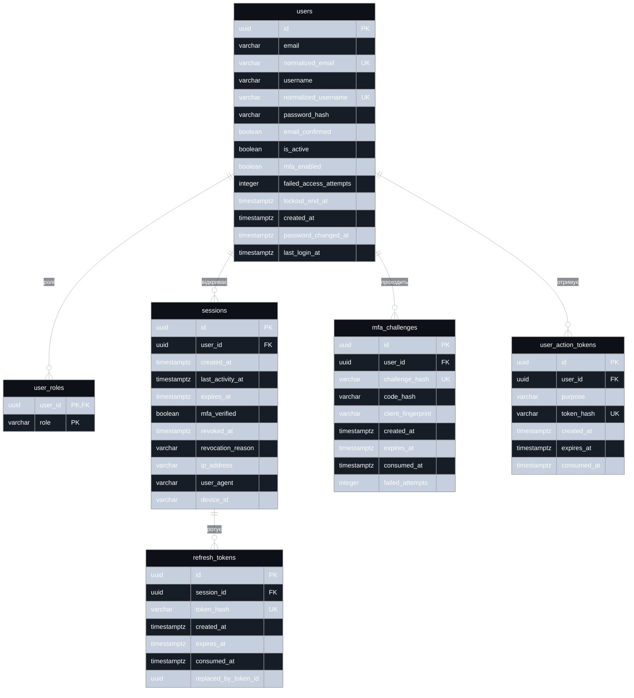

### 3. Реєстрація

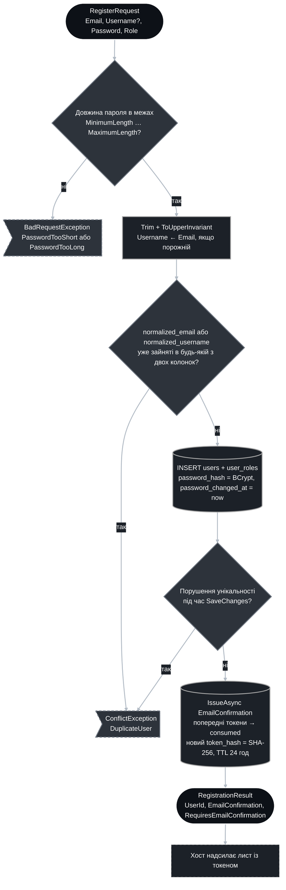

### 4. Підтвердження email

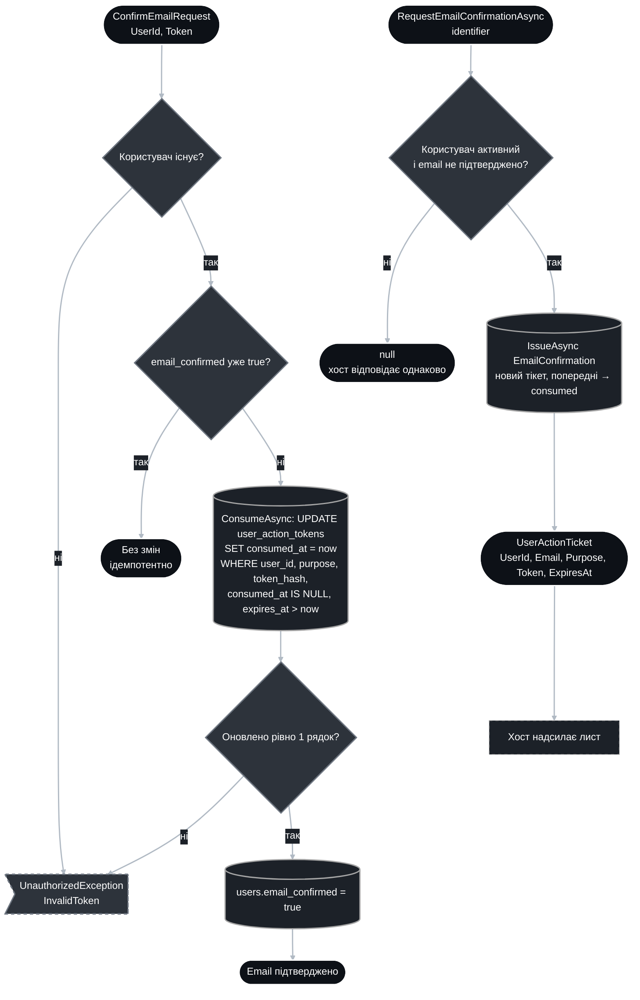

### 5. Вхід за паролем

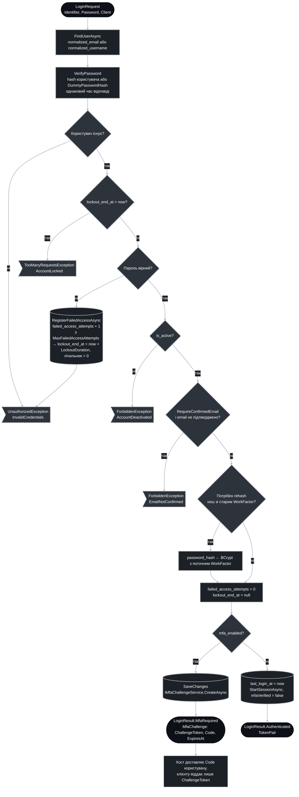

### 6. MFA-челендж

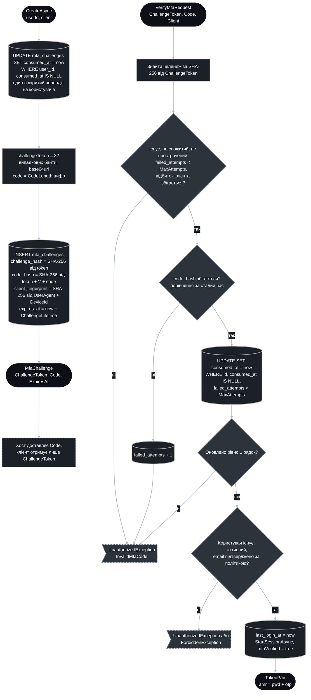

### 7. Відкриття сесії та склад токенів

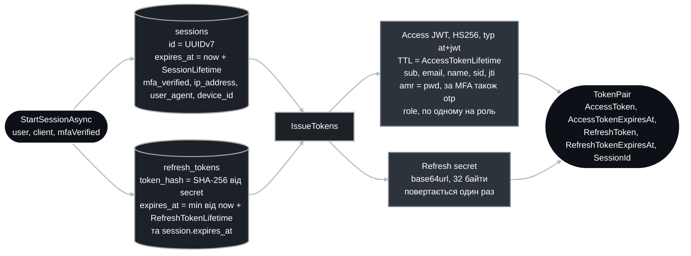

### 8. Оновлення токенів

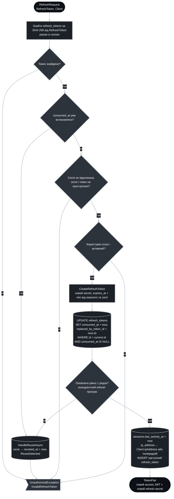

### 9. Відкликання сесій

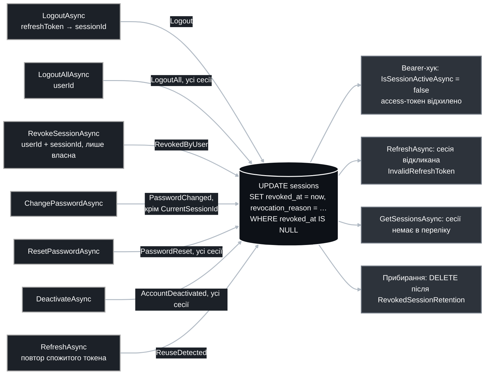

### 10. Перевірка access-токена на боці хоста

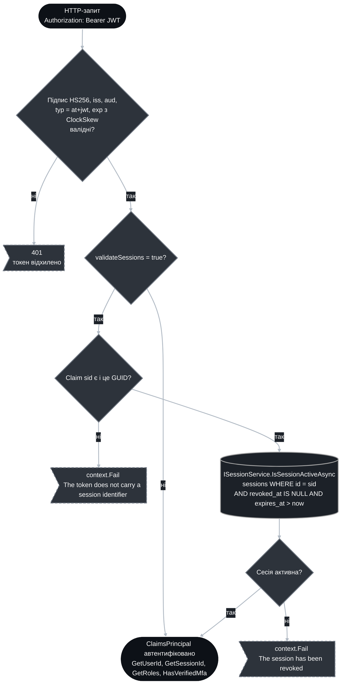

### 11. Зміна пароля

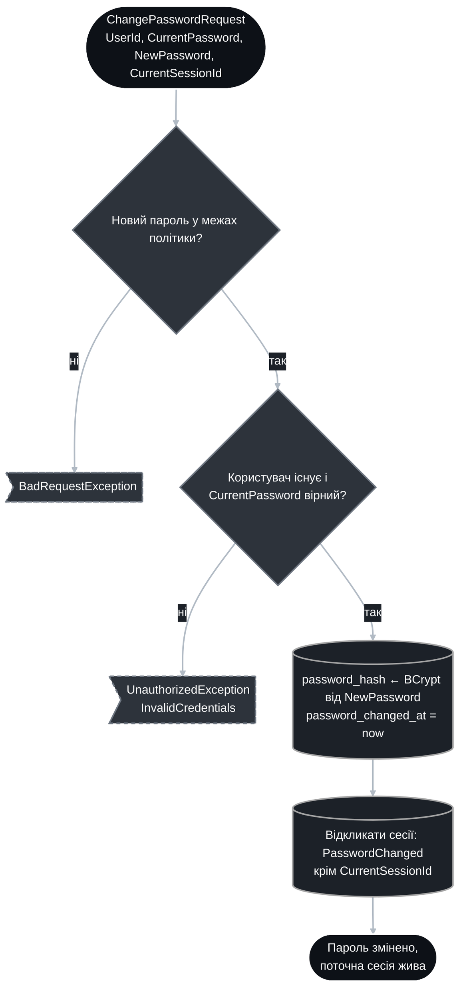

### 12. Відновлення пароля

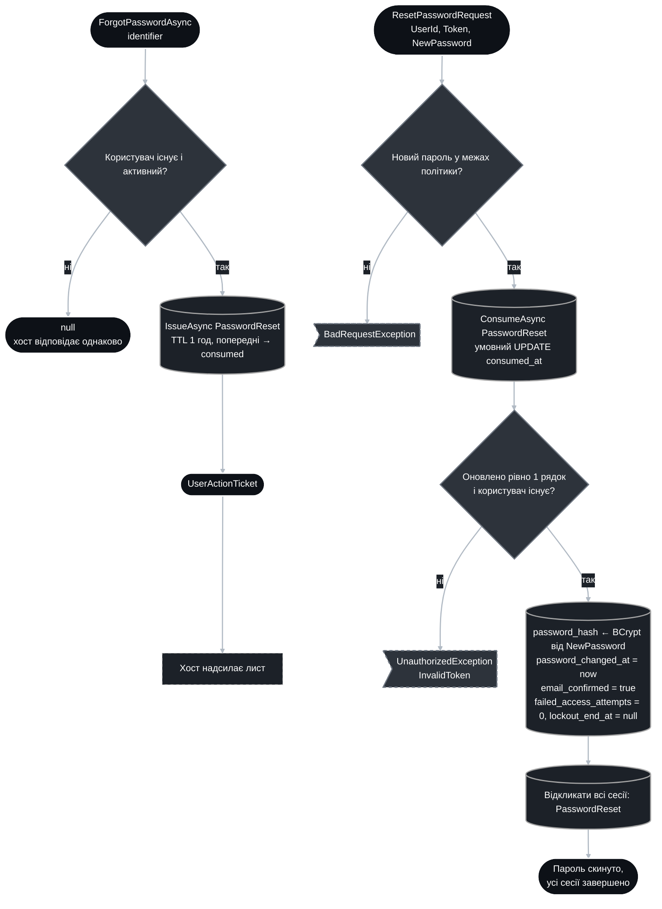

### 13. Керування MFA та адміністрування

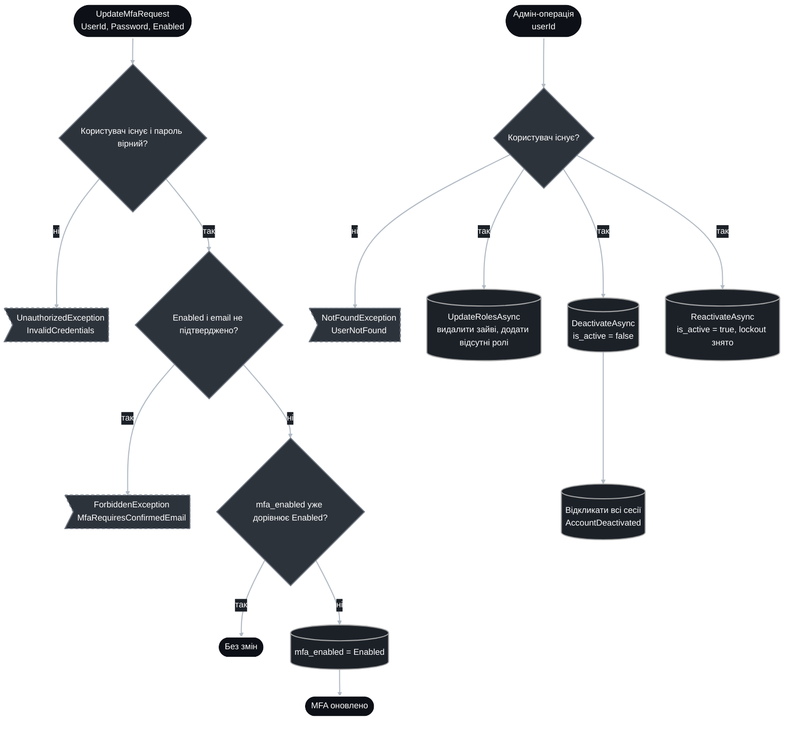

### 14. Фонове прибирання

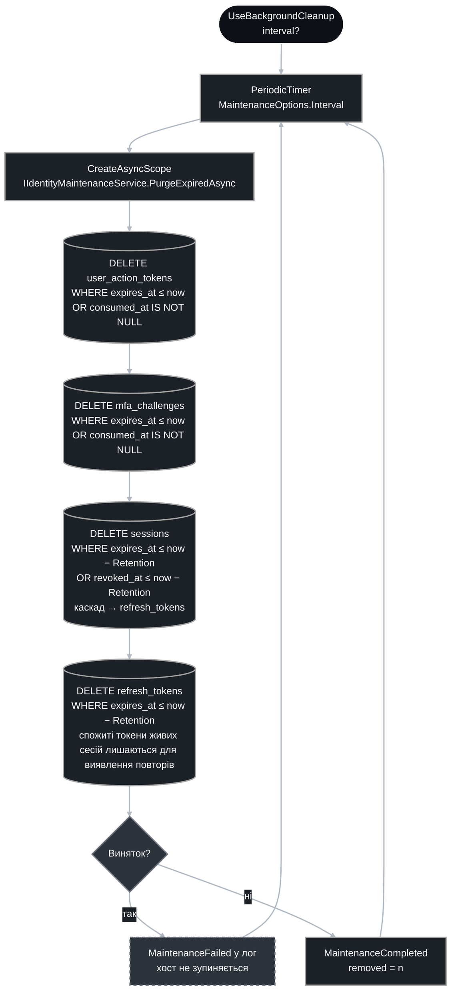

### 15. Композиція в DI

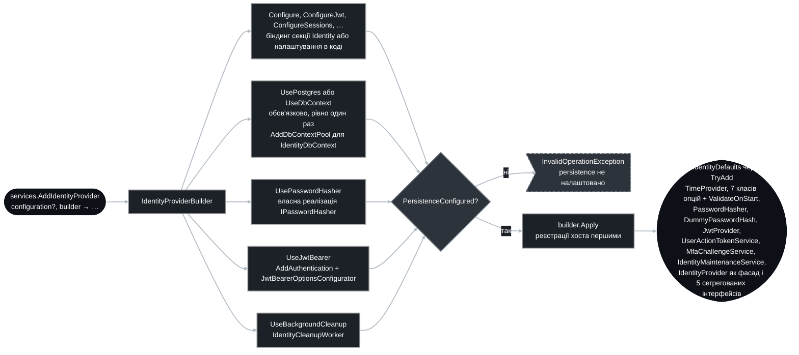

### 16. Параметри за замовчуванням

| Секція | Параметр | Значення | Де діє |
|--|--|--|--|
| `Jwt` | `AccessTokenLifetime` | 15 хв | діаграма 7 |
| `Jwt` | `ClockSkew` | 30 с | діаграма 10 |
| `Jwt` | `SigningKey` | обов'язковий, від 32 символів | діаграми 7, 10 |
| `Sessions` | `RefreshTokenLifetime` | 7 днів, ковзний | діаграми 7, 8 |
| `Sessions` | `SessionLifetime` | 30 днів, абсолютний | діаграми 7, 8 |
| `Sessions` | `RevokedSessionRetention` | 30 днів | діаграми 9, 14 |
| `Mfa` | `CodeLength` / `ChallengeLifetime` / `MaxAttempts` | 6 цифр / 5 хв / 5 | діаграма 6 |
| `UserActionTokens` | `EmailConfirmationLifetime` / `PasswordResetLifetime` | 24 год / 1 год | діаграми 3, 4, 12 |
| `Passwords` | `WorkFactor` / `MinimumLength` / `MaximumLength` | 12 / 8 / 128 | діаграми 3, 5, 11, 12 |
| `Account` | `RequireConfirmedEmail` | `true` | діаграми 5, 6 |
| `Account` | `MaxFailedAccessAttempts` / `LockoutDuration` | 5 / 15 хв, 0 вимикає lockout | діаграма 5 |
| `Maintenance` | `Interval` | 1 год | діаграма 14 |

### 17. Винятки

| Виняток | Коли | Діаграми |
|--|--|--|
| `UnauthorizedException` | невірні креденшали, невалідний або спожитий токен чи код | 4, 5, 6, 8, 11, 12, 13 |
| `ForbiddenException` | деактивований акаунт, непідтверджений email за політикою | 5, 6, 13 |
| `TooManyRequestsException` | активний lockout | 5 |
| `ConflictException` | дублікат email або username | 3 |
| `BadRequestException` | порушення політики довжини пароля | 3, 11, 12 |
| `NotFoundException` | адмін-операція над невідомим користувачем, видача тікета невідомому користувачу | 13 |

### 18. Відповідність потоків коду

| Потік | Файл |
|--|--|
| 3, 4 | `Base/IdentityProvider.SignUp.cs`, `Base/Tokens/UserActionTokenService.cs` |
| 5, 7, 8, 9 | `Base/IdentityProvider.SignIn.cs`, `Base/IdentityProvider.cs` |
| 6 | `Base/Tokens/MfaChallengeService.cs`, `Base/IdentityProvider.SignIn.cs` |
| 7 | `Base/Security/JwtProvider.cs`, `Base/Security/ClaimsBuilder.cs`, `Base/Security/TokenSecret.cs` |
| 9 | `Base/IdentityProvider.Sessions.cs` |
| 10 | `Base/Authentication/JwtBearerOptionsConfigurator.cs`, `Base/Authentication/ClaimsPrincipalExtensions.cs` |
| 11, 12, 13 | `Base/IdentityProvider.Account.cs`, `Base/IdentityProvider.Administration.cs` |
| 14 | `Base/Maintenance/IdentityCleanupWorker.cs`, `Base/Maintenance/IdentityMaintenanceService.cs` |
| 15 | `Base/Registration/IdentityRegistrar.cs`, `Base/Registration/IdentityProviderBuilder.cs` |
| 2 | `Base/Persistence/IdentityDbContext.cs`, `Base/Persistence/Configurations/*.cs` |
