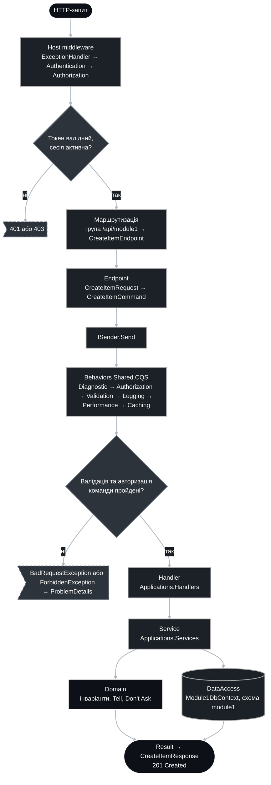

## Модульний моноліт

Звіт описує, як організувати бекенд як **модульний моноліт**: один процес і один артефакт розгортання, усередині якого бізнес-модулі ізольовані на рівні проєктів, даних і контрактів. Кожен модуль повторює горизонтальну структуру з `service-structure.md`, але замість власного `HostSide.WebApi` має шар **Endpoints**, який реєструється в єдиній вхідній точці. Модуль відповідає одному bounded context-у зі стратегічного дизайну.

Позначення в тексті: **Факт** — властивість підходу або поточного коду, **Інтерпретація** — висновок із фактів, **Рекомендація** — пропоноване рішення для системи.

### 1. Принципи

| Принцип | Зміст |
|--|--|
| Один артефакт розгортання | Один `Host.WebApi` та опційні окремі хости міграцій і фонових задач. Один pipeline CI/CD, одна конфігурація. |
| Жорсткі межі | Межа модуля дорівнює межі проєкту. Інший модуль посилається лише на `Contracts`. Реалізації `internal`. |
| Власні дані | Кожен модуль має власний `DbContext`, власну схему БД і власний проєкт міграцій. Крос-схемних FK і join-ів немає. |
| Єдина точка реєстрації | Хост не знає будови модулів. Він отримує перелік `IModule` і викликає два методи: реєстрацію залежностей і мапінг маршрутів. |
| Взаємодія через контракти | Синхронно через публічний фасад у `Contracts`, асинхронно через in-process події. Спільних транзакцій між модулями немає. |

### 2. Порівняння з класичним монолітом і мікросервісами

**Факти.** Властивості трьох підходів у термінах, що впливають на цю систему.

| Критерій | Класичний моноліт | Модульний моноліт | Мікросервіси |
|--|--|--|--|
| Одиниця розгортання | одна | одна | багато |
| Межі між частинами | умовні, тримаються на дисципліні | жорсткі: окремі проєкти, `internal`, архітектурні тести | фізичні: мережа |
| Дані | спільна схема, довільні join-и | схема на модуль, доступ лише через свій модуль | база на сервіс |
| Виклики між частинами | прямі виклики будь-чого | лише `Contracts` або події | HTTP, gRPC, брокер |
| Консистентність | одна транзакція на все | транзакція в межах модуля, між модулями — події | розподілена, eventual |
| Відмови | весь процес | весь процес | часткові, потрібні retry, timeout, circuit breaker |
| Налагодження і тести | один процес, просто | один процес, модуль тестується на межі `Contracts` і `Endpoints` | трасування, контрактні тести, інфраструктура для тестів |
| Масштабування | весь процес | весь процес | незалежно по сервісу |
| Інфраструктура | мінімальна | мінімальна | оркестрація, service discovery, брокер, спостережуваність |
| Вартість зміни меж | низька, але межі розмиваються | низька, межі зберігаються | висока: межа зафіксована мережевим контрактом |
| Виділення частини в сервіс | потрібно спочатку розплутати | модуль уже має `Contracts` і власну схему | не застосовно |

**Інтерпретація.**

- Проти класичного моноліту: компілятор і архітектурні тести не дають модулям зростись. Кожен модуль розвивається, тестується і замінюється окремо. Схема на модуль не дає зв'язати дані join-ами, які потім неможливо розірвати.
- Проти мікросервісів на поточному етапі: між модулями немає мережі, отже немає часткових відмов, серіалізації, розподілених транзакцій і версіонування API. Один деплой, одна конфігурація, один журнал. Межі ще можна дешево пересувати, поки домен уточнюється. Модульний моноліт зберігає переваги мікросервісів, що стосуються коду: ізоляцію, володіння, незалежні моделі. Він відкладає лише ті, що стосуються розгортання.
- Модульного моноліту недостатньо, коли один модуль потребує незалежного масштабування або іншого стеку, коли кілька команд потребують незалежного ритму релізів, або коли вимоги ізоляції даних потребують фізичного розділення. У такому разі виділяється конкретний модуль, а не вся система (розділ 8).

**Рекомендація.** Починати з модульного моноліту, тримати межі так, ніби модулі вже є сервісами, і виділяти модуль у сервіс лише за появи конкретної причини з переліку вище.

### 3. Структура рішення

**Рекомендація.** Пропонована розкладка на прикладі двох модулів. Назви `Module1` і `Module2` умовні; реальні модулі називаються за bounded context-ом.

```text
src/backend/
├─ Host/
│  ├─ NoMoreTears.Host.WebApi/              вхідна точка: Program.cs, ModuleCatalog, HostRegistrar
│  ├─ NoMoreTears.Host.Migrations/          опційно: міграції всіх модулів одним запуском
│  └─ NoMoreTears.Host.BackgroundJobs/      опційно: фонові задачі модулів
├─ Modules/
│  ├─ Module1/
│  │  ├─ Domain/                            без змін щодо service-structure.md
│  │  ├─ Infrastructures/DataAccess/        Module1DbContext, схема module1
│  │  ├─ Infrastructures/Migrations/        міграції лише цієї схеми
│  │  ├─ Applications/Services/
│  │  ├─ Applications/Handlers/
│  │  ├─ Contracts/                         єдина публічна поверхня для інших модулів
│  │  ├─ Providers/                         Module1Registrar
│  │  └─ Endpoints/                         Module1Module : IModule, класи IEndpoint
│  └─ Module2/                              той самий набір
└─ Shared/
   ├─ Common/  CQS/  Postgres/  Providers/Identity/
   └─ Hosting/
      ├─ Abstractions/                      IModule, IEndpoint
      └─ Base/                              ModuleRegistrar
```

Відповідність шарам із `service-structure.md`:

| Шар | У модульному моноліті |
|--|--|
| Domain, Infrastructures.DataAccess, Applications.Services, Applications.Handlers | Без змін. Живуть усередині модуля, посилання між модулями на ці проєкти заборонені. |
| Contracts | Без змін за змістом. Стає єдиним проєктом модуля, на який можуть посилатись інші модулі та хости. |
| Providers | `Module1Registrar` реєструє все всередині модуля. Викликається лише з `Endpoints`. |
| HostSide.WebApi | Замінюється шаром `Endpoints` у кожному модулі та одним спільним `Host.WebApi`. |
| HostSide.Migrations, BackgroundJobs, Consumers, SignalR | Лишаються окремими хостами, але теж композиційними: збирають модулі через той самий `ModuleCatalog`. Модуль за потреби реалізує необов'язкові розширення `IModule`, наприклад `IMigrationModule`. |

### 4. Вхідна точка та центральна реєстрація

**Факт.** У поточному коді `Shared` уже використовує патерн реєстраторів: `IdentityRegistrar`, `PostgresRegistrar`, `CqsRegistrar`. Реєстрація явна, без сканування збірок на рівні хоста.

**Рекомендація.** Хост має рівно одне місце, де перелічено модулі, і рівно два виклики на модуль.

```mermaid
%%{init: {"theme":"base","themeVariables":{"fontFamily":"Segoe UI, Helvetica, Arial, sans-serif","primaryColor":"#1C2128","primaryTextColor":"#FFFFFF","primaryBorderColor":"#A5A5A5","lineColor":"#B1BAC4","edgeLabelBackground":"#1C2128","clusterBkg":"#0D1117","clusterBorder":"#A5A5A5","titleColor":"#FFFFFF"}}}%%
flowchart TD
    accTitle: Вхідна точка та центральна реєстрація модулів
    accDescr: Program.cs хоста WebApi реєструє спільні сервіси Shared один раз і передає перелік модулів із ModuleCatalog у ModuleRegistrar. Той для кожного модуля викликає AddModule для реєстрації залежностей через Registrar модуля і MapEndpoints для підключення групи маршрутів модуля. Endpoints модуля викликають handler-и лише через ISender.

    Program(["Host.WebApi<br/>Program.cs"]) --> HostReg["HostRegistrar<br/>Shared: CQS pipeline, винятки → ProblemDetails,<br/>Identity + JwtBearer, OpenAPI"]
    Program --> Catalog["ModuleCatalog<br/>явний перелік: Module1Module, Module2Module"]
    Catalog --> Reg["ModuleRegistrar<br/>AddModules + MapModules"]

    subgraph MOD1["Module1"]
        M1M["Module1Module : IModule<br/>Endpoints"]
        M1R["Module1Registrar<br/>Providers"]
        M1E["IEndpoint-и<br/>група /api/module1"]
        M1L["Handlers · Services · DataAccess · Domain"]
    end

    subgraph MOD2["Module2"]
        M2M["Module2Module : IModule<br/>Endpoints"]
        M2R["Module2Registrar<br/>Providers"]
        M2E["IEndpoint-и<br/>група /api/module2"]
        M2L["Handlers · Services · DataAccess · Domain"]
    end

    Reg -->|"AddModule<br/>MapEndpoints"| M1M
    Reg -->|"AddModule<br/>MapEndpoints"| M2M
    M1M --> M1R --> M1L
    M1M --> M1E -->|"ISender"| M1L
    M2M --> M2R --> M2L
    M2M --> M2E -->|"ISender"| M2L

    classDef core fill:#0D1117,color:#FFFFFF,stroke:#FFFFFF,stroke-width:2px;
    classDef support fill:#1C2128,color:#FFFFFF,stroke:#A5A5A5,stroke-width:2px;
    classDef generic fill:#2D333B,color:#FFFFFF,stroke:#6E7681,stroke-width:2px;
    classDef cross fill:#22272E,color:#FFFFFF,stroke:#6E7681,stroke-width:1px,stroke-dasharray: 5 5;

    class Program,Reg core;
    class Catalog,M1M,M2M support;
    class M1R,M2R,M1E,M2E generic;
    class HostReg,M1L,M2L cross;

    style MOD1 fill:#0D1117,stroke:#A5A5A5,stroke-width:1px,stroke-dasharray: 5 5
    style MOD2 fill:#0D1117,stroke:#A5A5A5,stroke-width:1px,stroke-dasharray: 5 5

    linkStyle default stroke:#B1BAC4,stroke-width:2px,color:#FFFFFF
```



#### 4.1. Контракт модуля

Проєкт `Shared/Hosting/Abstractions`. На нього посилаються `Endpoints` кожного модуля та хости.

```csharp
public interface IModule
{
    /// <summary>
    ///     Ім'я модуля в нижньому регістрі: префікс маршрутів, секція конфігурації, схема БД.
    /// </summary>
    string Name { get; }

    /// <summary>
    ///     Реєструє всі залежності модуля. Хост викликає один раз.
    /// </summary>
    IServiceCollection AddModule(IServiceCollection services, IConfiguration configuration);

    /// <summary>
    ///     Підключає маршрути модуля до групи, яку створив хост.
    /// </summary>
    void MapEndpoints(RouteGroupBuilder group);
}

public interface IEndpoint
{
    void Map(RouteGroupBuilder group);
}
```

#### 4.2. Центральний реєстратор

Проєкт `Shared/Hosting/Base`. Хост володіє префіксом і спільними конвенціями групи, модуль наповнює групу.

```csharp
public static class ModuleRegistrar
{
    extension(IServiceCollection services)
    {
        public IServiceCollection AddModules(
            IConfiguration configuration,
            IReadOnlyList<IModule> modules)
        {
            foreach (var module in modules)
            {
                module.AddModule(services, configuration.GetSection(module.Name));
            }

            return services;
        }
    }

    extension(IEndpointRouteBuilder endpoints)
    {
        public IEndpointRouteBuilder MapModules(IReadOnlyList<IModule> modules)
        {
            foreach (var module in modules)
            {
                var group = endpoints
                    .MapGroup("/api/" + module.Name)
                    .WithTags(module.Name);

                module.MapEndpoints(group);
            }

            return endpoints;
        }
    }
}
```

#### 4.3. Вхідна точка

Проєкт `Host/NoMoreTears.Host.WebApi`. `Program.cs` не містить нічого, крім композиції.

```csharp
internal static class ModuleCatalog
{
    public static IReadOnlyList<IModule> All { get; } =
    [
        new Module1Module(),
        new Module2Module()
    ];
}
```

```csharp
var builder = WebApplication.CreateBuilder(args);

builder.Services
    .AddHostDefaults(builder.Configuration)
    .AddModules(builder.Configuration, ModuleCatalog.All);

var app = builder.Build();

app.UseHostDefaults();
app.MapModules(ModuleCatalog.All);

app.Run();
```

`HostRegistrar.AddHostDefaults` реєструє те, що є одне на процес: MediatR і pipeline behaviors з `Shared.CQS`, мапінг винятків `Shared.Common.Exceptions` у ProblemDetails, `AddIdentityProvider(...).UseJwtBearer()`, OpenAPI. `UseHostDefaults` підключає exception handler, автентифікацію та авторизацію.

**Факт.** Поточний `CqsRegistrar.AddCqs` приймає одну збірку і додає behaviors при кожному виклику. Якщо кожен модуль викличе `AddCqs`, behaviors зареєструються стільки разів, скільки є модулів, і виконуватимуться повторно. **Рекомендація.** Хост один раз реєструє MediatR і behaviors; модуль реєструє лише свої handler-и та validator-и через наявний публічний `AddCqsHandlersFromAssembly`. Для цього `CqsRegistrar` розширюється двома методами: `AddCqsPipeline(Action<CqsOptions>)` для хоста і `AddCqsHandlers<TMarker>()` для модуля.

### 5. Шар Endpoints

**Рекомендація.** `Endpoints` є презентаційним шаром модуля і єдиним місцем, де існує HTTP. Правила з `service-structure.md` для `HostSide.WebApi` діють тут без змін: Minimal API, виклик через `ISender`, без суфікса `Async` у методах endpoint-ів, без логіки.

```mermaid
%%{init: {"theme":"base","themeVariables":{"fontFamily":"Segoe UI, Helvetica, Arial, sans-serif","primaryColor":"#1C2128","primaryTextColor":"#FFFFFF","primaryBorderColor":"#A5A5A5","lineColor":"#B1BAC4","edgeLabelBackground":"#1C2128","clusterBkg":"#0D1117","clusterBorder":"#A5A5A5","titleColor":"#FFFFFF"}}}%%
flowchart TD
    accTitle: Структура одного модуля з шаром Endpoints
    accDescr: Хост викликає AddModule і MapEndpoints на шарі Endpoints. Endpoints мапить HTTP-запит у команду або запит і надсилає через ISender у Handlers. Handlers делегують у Services, Services виконують логіку Domain і оркеструють DataAccess. Providers реєструє Handlers, Services і DataAccess. Contracts містить запити, відповіді, події та публічний фасад, і це єдиний проєкт, на який посилається інший модуль.

    Host["Host.WebApi<br/>ModuleRegistrar"] -->|"AddModule<br/>MapEndpoints"| Ep

    subgraph MODULE["Module1"]
        Ep["Endpoints<br/>Module1Module : IModule<br/>CreateItemEndpoint : IEndpoint"]
        Prov["Providers<br/>Module1Registrar"]
        Contr["Contracts<br/>Request, Response, Event,<br/>IModule1Api"]
        Hndl["Applications.Handlers<br/>CQS"]
        Svc["Applications.Services"]
        Dal["Infrastructures.DataAccess<br/>Module1DbContext, схема module1"]
        Dom["Domain"]
    end

    Ep -->|"ISender: Command, Query"| Hndl
    Ep -.->|"Request → Command<br/>Result → Response"| Contr
    Ep -->|"AddModule1"| Prov
    Prov -.->|"реєструє"| Hndl & Svc & Dal
    Hndl -->|"делегує"| Svc
    Svc -->|"виконує логіку"| Dom
    Dal -->|"конфігурує моделі"| Dom
    Svc -.->|"оркеструє доступ"| Dal
    Other["Module2"] -.->|"лише Contracts"| Contr

    classDef core fill:#0D1117,color:#FFFFFF,stroke:#FFFFFF,stroke-width:2px;
    classDef app fill:#161B22,color:#FFFFFF,stroke:#C9D1D9,stroke-width:2px;
    classDef infra fill:#1C2128,color:#FFFFFF,stroke:#A5A5A5,stroke-width:2px;
    classDef host fill:#2D333B,color:#FFFFFF,stroke:#6E7681,stroke-width:2px;
    classDef cross fill:#22272E,color:#FFFFFF,stroke:#6E7681,stroke-width:1px,stroke-dasharray: 5 5;

    class Dom core;
    class Hndl,Svc app;
    class Dal infra;
    class Ep,Host,Other host;
    class Prov,Contr cross;

    style MODULE fill:#0D1117,stroke:#A5A5A5,stroke-width:1px,stroke-dasharray: 5 5

    linkStyle default stroke:#B1BAC4,stroke-width:2px,color:#FFFFFF
```



#### 5.1. Модуль і його endpoint-и

Проєкт `Modules/Module1/Endpoints`. Перелік endpoint-ів явний, як і перелік модулів у хості.

```csharp
public sealed class Module1Module : IModule
{
    private static readonly IEndpoint[] Endpoints =
    [
        new CreateItemEndpoint(),
        new GetItemEndpoint()
    ];

    public string Name => "module1";

    public IServiceCollection AddModule(
        IServiceCollection services,
        IConfiguration configuration) =>
        services.AddModule1(configuration);

    public void MapEndpoints(RouteGroupBuilder group)
    {
        foreach (var endpoint in Endpoints)
        {
            endpoint.Map(group);
        }
    }
}
```

```csharp
internal sealed class CreateItemEndpoint : IEndpoint
{
    public void Map(RouteGroupBuilder group) =>
        group
            .MapPost("/items", Handle)
            .RequireAuthorization()
            .Produces<CreateItemResponse>(StatusCodes.Status201Created);

    private static async Task<IResult> Handle(
        CreateItemRequest request,
        ISender sender,
        CancellationToken cancellationToken)
    {
        var itemId = await sender.Send(new CreateItemCommand(request.Title), cancellationToken);

        return Results.Created($"/api/module1/items/{itemId}", new CreateItemResponse(itemId));
    }
}
```

#### 5.2. Реєстратор модуля

Проєкт `Modules/Module1/Providers`. Єдине місце, яке знає про всі внутрішні реалізації модуля.

```csharp
public static class Module1Registrar
{
    extension(IServiceCollection services)
    {
        public IServiceCollection AddModule1(IConfiguration configuration) =>
            services
                .AddCqsHandlers<Module1HandlersMarker>()
                .AddPostgres<Module1DbContext, Module1DbContextForge>()
                .AddScoped<IItemService, ItemService>()
                .AddScoped<IModule1Api, Module1Api>();
    }
}
```

Правила шару:

- Endpoint приймає `*Request`, повертає `*Response` або `IResult`; мапінг ручний, у самому endpoint-і або в `Contracts`.
- Endpoint не містить логіки, умов і доступу до даних. Усе, що складніше за мапінг, належить handler-у.
- Авторизація задається на групі або endpoint-і через політики; перевірка ролей у домені виконується `AuthorizationBehavior` з `Shared.CQS`.
- Версія API, якщо знадобиться, задається на рівні групи модуля, а не окремого endpoint-а.

### 6. Життєвий цикл запиту



### 7. Межі та взаємодія модулів

**Рекомендація.** Дозволені та заборонені зв'язки між модулями.

```mermaid
%%{init: {"theme":"base","themeVariables":{"fontFamily":"Segoe UI, Helvetica, Arial, sans-serif","primaryColor":"#1C2128","primaryTextColor":"#FFFFFF","primaryBorderColor":"#A5A5A5","lineColor":"#B1BAC4","edgeLabelBackground":"#1C2128","clusterBkg":"#0D1117","clusterBorder":"#A5A5A5","titleColor":"#FFFFFF"}}}%%
flowchart LR
    accTitle: Дозволені та заборонені зв'язки між модулями
    accDescr: Module1 звертається до Module2 лише двома шляхами: синхронно через публічний фасад IModule2Api у Contracts Module2 або асинхронно через подію Module1 у in-process шині, на яку підписаний consumer у Module2. Прямі посилання на Services, Domain або DataAccess іншого модуля заборонені, як і доступ до чужої схеми БД. Кожен модуль має власну схему в одній базі PostgreSQL.

    subgraph M1["Module1"]
        S1["Applications.Services"]
        C1["Contracts<br/>ItemCreatedEvent"]
        D1[("схема module1")]
    end

    subgraph BUS["Shared: шина подій"]
        Bus["INotification / Channel<br/>Outbox у схемі модуля-відправника"]
    end

    subgraph M2["Module2"]
        C2["Contracts<br/>IModule2Api"]
        S2["Applications.Services"]
        H2["Consumer<br/>ItemCreatedEvent"]
        D2[("схема module2")]
    end

    S1 -->|"дозволено: синхронний виклик"| C2
    C2 -.->|"реалізація internal"| S2
    S1 -->|"дозволено: публікує"| C1
    C1 --> Bus --> H2
    H2 --> S2
    S1 --> D1
    S2 --> D2
    S1 -.-|"заборонено: пряме посилання"| S2
    S1 -.-|"заборонено: чужа схема, join, FK"| D2

    classDef core fill:#0D1117,color:#FFFFFF,stroke:#FFFFFF,stroke-width:2px;
    classDef support fill:#1C2128,color:#FFFFFF,stroke:#A5A5A5,stroke-width:2px;
    classDef generic fill:#2D333B,color:#FFFFFF,stroke:#6E7681,stroke-width:2px;
    classDef cross fill:#22272E,color:#FFFFFF,stroke:#6E7681,stroke-width:1px,stroke-dasharray: 5 5;

    class C1,C2 core;
    class S1,S2,H2 support;
    class D1,D2 generic;
    class Bus cross;

    style M1 fill:#0D1117,stroke:#A5A5A5,stroke-width:1px,stroke-dasharray: 5 5
    style M2 fill:#0D1117,stroke:#A5A5A5,stroke-width:1px,stroke-dasharray: 5 5
    style BUS fill:#0D1117,stroke:#6E7681,stroke-width:1px,stroke-dasharray: 5 5

    linkStyle default stroke:#B1BAC4,stroke-width:2px,color:#FFFFFF
```



Правила:

| Правило | Як забезпечується |
|--|--|
| Посилання між модулями лише на `Contracts` | Посилання між проєктами плюс архітектурний тест на залежності збірок, наприклад NetArchTest.Rules або ArchUnitNET. |
| Реалізації `internal` | `InternalsVisibleTo` лише для тестових проєктів модуля. Так само зроблено в `Shared/Providers/Identity`. |
| Схема на модуль | `HasDefaultSchema("module1")` у `DbContext`, окремий проєкт міграцій. Зразок: схема `identity` в `IdentityDbContext`. |
| Без спільних транзакцій | Транзакція живе в межах одного `DbContext`. Між модулями консистентність eventual через події та outbox у схемі відправника. |
| Публічний фасад замість спільної моделі | `IModule2Api` у `Contracts` повертає `*Response`, а не доменні моделі. Споживач не бачить `Domain` іншого модуля. |
| Спільний код лише в `Shared` | Технічні блоки без бізнес-знань: винятки, CQS, Postgres, Identity. Доменні типи в `Shared` не потрапляють. |

### 8. Виділення модуля в окремий сервіс

**Інтерпретація.** Оскільки модуль уже має власну схему, власні міграції, `Contracts` як єдину поверхню і спілкується подіями, виділення зводиться до заміни транспорту без зміни внутрішніх шарів.

```mermaid
%%{init: {"theme":"base","themeVariables":{"fontFamily":"Segoe UI, Helvetica, Arial, sans-serif","primaryColor":"#1C2128","primaryTextColor":"#FFFFFF","primaryBorderColor":"#A5A5A5","lineColor":"#B1BAC4","edgeLabelBackground":"#1C2128","clusterBkg":"#0D1117","clusterBorder":"#A5A5A5","titleColor":"#FFFFFF"}}}%%
flowchart LR
    accTitle: Виділення модуля в окремий сервіс
    accDescr: На першому етапі обидва модулі живуть в одному хості, спілкуються через in-process шину і фасад у Contracts, схеми в одній базі. На другому етапі Module2 отримує власний хост, фасад IModule2Api реалізується HTTP або gRPC клієнтом у Module1, in-process шина замінюється брокером, схема module2 переїжджає в окрему базу. Шари Domain, Services, Handlers і Endpoints Module2 не змінюються.

    subgraph STAGE1["Етап 1: один хост"]
        A1["Host.WebApi"]
        A2["Module1"]
        A3["Module2"]
        A4["in-process шина"]
        A5[("PostgreSQL<br/>схеми module1, module2")]
        A1 --> A2 & A3
        A2 -->|"IModule2Api<br/>in-process"| A3
        A2 --> A4 --> A3
        A2 --> A5
        A3 --> A5
    end

    subgraph STAGE2["Етап 2: Module2 виділено"]
        B1["Host.WebApi<br/>Module1"]
        B2["Host.Module2<br/>той самий Module2Module"]
        B3["Брокер повідомлень"]
        B4[("PostgreSQL<br/>схема module1")]
        B5[("PostgreSQL<br/>схема module2")]
        B1 -->|"IModule2Api<br/>HTTP або gRPC клієнт"| B2
        B1 --> B3 --> B2
        B1 --> B4
        B2 --> B5
    end

    STAGE1 ==>|"замінити транспорт:<br/>фасад → клієнт, шина → брокер,<br/>схема → окрема база"| STAGE2

    classDef core fill:#0D1117,color:#FFFFFF,stroke:#FFFFFF,stroke-width:2px;
    classDef support fill:#1C2128,color:#FFFFFF,stroke:#A5A5A5,stroke-width:2px;
    classDef generic fill:#2D333B,color:#FFFFFF,stroke:#6E7681,stroke-width:2px;
    classDef cross fill:#22272E,color:#FFFFFF,stroke:#6E7681,stroke-width:1px,stroke-dasharray: 5 5;

    class A1,B1,B2 core;
    class A2,A3 support;
    class A5,B4,B5 generic;
    class A4,B3 cross;

    style STAGE1 fill:#0D1117,stroke:#A5A5A5,stroke-width:1px,stroke-dasharray: 5 5
    style STAGE2 fill:#0D1117,stroke:#FFFFFF,stroke-width:1px,stroke-dasharray: 5 5

    linkStyle default stroke:#B1BAC4,stroke-width:2px,color:#FFFFFF
```



Кроки виділення: створити хост із тим самим `Module2Module`, реалізувати `IModule2Api` у `Module1` як HTTP або gRPC клієнт, замінити in-process шину на брокер зі збереженням контрактів подій, перенести схему `module2` в окрему базу через наявний проєкт міграцій, вилучити `Module2Module` з `ModuleCatalog` першого хоста.

### 9. Правила дизайну

- `Program.cs` хоста містить лише композицію. Решта в `HostRegistrar` і `ModuleRegistrar`.
- Перелік модулів і перелік endpoint-ів явні. Сканування збірок допускається лише для handler-ів і validator-ів усередині модуля, як це вже робить `Shared.CQS`.
- Реєстратори називаються `*Registrar`, модулі `*Module`, endpoint-и `*Endpoint`. Без `*Extensions`, `*Di`, `*Dto`.
- Один модуль дорівнює одному bounded context-у. Один модуль має один `DbContext`, одну схему, один проєкт міграцій, одну секцію конфігурації з ім'ям модуля.
- Контракти між модулями версіонуються як зовнішнє API: зміна `Contracts` є зміною контракту, а не рефакторингом.
- Модуль тестується на двох межах: `Endpoints` інтеграційними тестами хоста з одним модулем у каталозі та `Contracts` для фасаду і подій.
- Архітектурний тест на залежності збірок запускається в CI разом із модульними тестами.
- Усе, що є одним на процес: MediatR, behaviors, автентифікація, обробка винятків, OpenAPI, реєструє хост, а не модуль.

### 10. Корисні ресурси

- Kamil Grzybek, «Modular Monolith: A Primer»: https://www.kamilgrzybek.com/blog/posts/modular-monolith-primer
- Martin Fowler, «MonolithFirst»: https://martinfowler.com/bliki/MonolithFirst.html
- Sam Newman, «Monolith to Microservices», O'Reilly, 2019.
